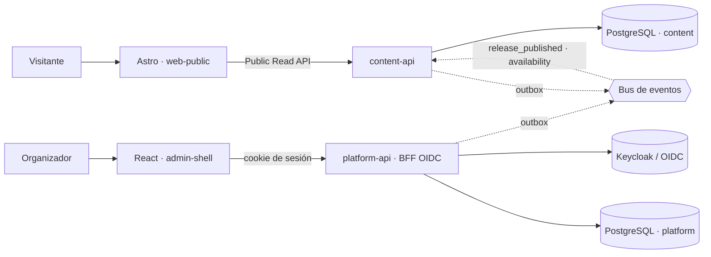

# IncubaUNAS — Content & Platform Foundation (Equipo 1)

Parte del **Equipo 1** de la [plataforma de eventos, congresos y convocatorias](https://github.com/juancxdev/event-platform-architecture): sitios públicos, CMS, identidad, organizaciones (tenants), dominios y la base compartida para los equipos 2 a 4.

> El repositorio es **público**. No se versionan secretos: todo valor sensible va en `.env` (ignorado por git) y `.env.example` solo trae valores de desarrollo local.

## Qué hay aquí

| Pieza                                            | Qué hace                                                                                                                                                                                                                           | Estado  |
| ------------------------------------------------ | ---------------------------------------------------------------------------------------------------------------------------------------------------------------------------------------------------------------------------------- | ------- |
| [`contracts/`](contracts)                        | OpenAPI 3.1 (Platform, CMS, Public Read), AsyncAPI y JSON Schemas de eventos, con un _gate_ que los valida en CI                                                                                                                   | Hecho   |
| [`services/platform-api`](services/platform-api) | Organizaciones, membresías, invitaciones, sesiones OIDC (BFF), cuentas de servicio, dominios y auditoría                                                                                                                           | Hecho   |
| [`services/content-api`](services/content-api)   | CMS (sitios, páginas, bloques, medios, vista previa), publicaciones inmutables, proyección pública de eventos                                                                                                                      | Hecho   |
| [`apps/web-public`](apps/web-public)             | Sitio público en Astro con el diseño "Nexus Horizon" del equipo de frontend, sobre la Public Read API (inicio, eventos, agenda, páginas del CMS, vista previa) ([ADR 0007](docs/adr/0007-frontend-nexus-horizon-en-web-public.md)) | Hecho   |
| [`apps/admin-shell`](apps/admin-shell)           | Panel React: login, organización activa, navegación por permisos, miembros, sesiones, auditoría                                                                                                                                    | Parcial |
| [`packages/*`](packages)                         | Kernel compartido, autorización y tenant, PostgreSQL y migraciones, eventos (outbox/inbox), kit HTTP desde OpenAPI                                                                                                                 | Hecho   |

La cobertura historia por historia (PF-001 a PF-055) está en [`docs/COBERTURA-EQUIPO-1.md`](docs/COBERTURA-EQUIPO-1.md): **17 hechas, 20 parciales y 3 pendientes**, con lo que falta de cada una.

## Contratos

Los contratos se escriben **antes** que el código y viven en [`contracts/`](contracts). Un _gate_ (`pnpm contracts:lint`, también en CI) los valida con Spectral y reglas propias: `Idempotency-Key` en los `POST`, `If-Match` y `412` en los `PATCH`, cuerpos con `additionalProperties: false`, sin `organization_id` en los cuerpos, nombres en `snake_case`, errores `problem+json`, ejemplos de eventos válidos y sin datos personales en los eventos.

| Contrato                                                                           | Qué define                                                                                                                                                                                                                                                                                                                            |
| ---------------------------------------------------------------------------------- | ------------------------------------------------------------------------------------------------------------------------------------------------------------------------------------------------------------------------------------------------------------------------------------------------------------------------------------- |
| [`openapi/platform.v1.yaml`](contracts/openapi/platform.v1.yaml)                   | **Platform API** (29 operaciones): login OIDC (BFF), `me` y sesiones, organizaciones, membresías, invitaciones, cuentas de servicio, dominios, resolución de host y auditoría                                                                                                                                                         |
| [`openapi/cms.v1.yaml`](contracts/openapi/cms.v1.yaml)                             | **CMS** (13 operaciones): sitios, páginas, bloques, tokens de vista previa, publicaciones, restauraciones y subida de medios                                                                                                                                                                                                          |
| [`openapi/public-read.v1.yaml`](contracts/openapi/public-read.v1.yaml)             | **Lectura pública** (5 operaciones): sitio, página, catálogo y detalle de eventos, vista previa. Es lo único que consume el sitio Astro                                                                                                                                                                                               |
| [`openapi/common.v1.yaml`](contracts/openapi/common.v1.yaml)                       | Piezas compartidas: errores `problem+json`, paginación por cursor, `ETag`, ids, zonas horarias                                                                                                                                                                                                                                        |
| [`asyncapi/platform-content.v1.yaml`](contracts/asyncapi/platform-content.v1.yaml) | **Eventos** (AsyncAPI 3.0). Publicamos `platform.organization.lifecycle_changed`, `platform.membership.changed`, `platform.domain.activated` y `content.page.published`. Consumimos `configuration.event.release_published`, `configuration.event.cancelled`, `configuration.schedule.changed` y `participation.availability.changed` |
| [`schemas/envelope.v1.json`](contracts/schemas/envelope.v1.json)                   | Sobre común de todo evento: ids del mensaje y del evento de dominio, `topic`, versión del esquema, productor, organización, fechas, actor, `traceparent` y correlación, agregado y clave de partición                                                                                                                                 |
| [`schemas/events/*.v1.json`](contracts/schemas/events)                             | Un JSON Schema por evento (8 en total); cada evento se valida contra el suyo antes de escribirse en el _outbox_                                                                                                                                                                                                                       |
| [`schemas/release-manifest.v1.json`](contracts/schemas/release-manifest.v1.json)   | Manifiesto de la publicación de un evento. **Es un supuesto** nuestro a la espera de confirmarlo con el Equipo 2                                                                                                                                                                                                                      |
| [`catalog.team1.json`](contracts/catalog.team1.json)                               | Qué operaciones del catálogo de la arquitectura cubrimos (40) y cuáles añadimos (7)                                                                                                                                                                                                                                                   |

Las rutas HTTP se **generan desde el OpenAPI**: si falta un _handler_ o sobra uno, el servicio no arranca. Los tipos de `apps/web-public` también salen de él (`pnpm --filter @incubaunas/web-public generate:api`).

## Cómo funciona



- **Contrato primero.** Cada ruta HTTP se genera desde el OpenAPI: si falta un _handler_ o sobra uno, el servicio no arranca. Cada respuesta de las pruebas se valida contra el contrato.
- **Aislamiento por organización en la base de datos.** `FORCE ROW LEVEL SECURITY` con un rol que no puede saltarse RLS; el tenant sale del token o de la sesión, nunca del cuerpo.
- **Publicar es inmutable.** Cada publicación guarda un snapshot con hash; restaurar crea una publicación nueva.
- **La lectura pública no toca el núcleo.** Astro lee una proyección ya publicada, cacheable por CDN con `ETag` y `Surrogate-Key`.

Las decisiones están en [`docs/adr/`](docs/adr).

## Empezar

Requisitos: Node 24, pnpm 12, Docker Desktop (con WSL 2 en Windows).

```bash
pnpm install
cp .env.example .env          # valores de desarrollo; cambia los secretos fuera de local
pnpm db:up                    # PostgreSQL con un rol de migración y uno de runtime por servicio
pnpm --filter @incubaunas/platform-api migrate
pnpm --filter @incubaunas/content-api migrate
pnpm check                    # lint + tipos + contratos + pruebas
```

## Probarlo en local

Levantar todo (Keycloak y Mailpit incluidos). Cada servidor va en su propia terminal:

```bash
pnpm stack:up                                     # PostgreSQL, Keycloak y Mailpit
pnpm --filter @incubaunas/platform-api start      # API de identidad y organizaciones
pnpm --filter @incubaunas/content-api start       # API del CMS y de lectura pública
pnpm --filter @incubaunas/content-api seed:demo   # sitio "demo" con páginas y un evento de ejemplo
pnpm --filter @incubaunas/web-public dev          # sitio público (con recarga en caliente)
pnpm --filter @incubaunas/admin-shell dev         # panel de administración
```

Para ver el sitio público tal como se despliega (compilado, con la CSP real) usa `pnpm --filter @incubaunas/web-public build` y luego `... start`.

| Qué                                                         | URL                     |
| ----------------------------------------------------------- | ----------------------- |
| Sitio público (diseño del equipo de frontend)               | <http://localhost:4321> |
| Panel de administración                                     | <http://localhost:3000> |
| Platform API / Content API                                  | `:4000` / `:4001`       |
| Keycloak (inicio de sesión y consola de admin)              | <http://localhost:8080> |
| Mailpit (correos que envía el sistema, p. ej. invitaciones) | <http://localhost:8025> |

Páginas del sitio público: `/` (portada y próximos eventos), `/eventos`, `/eventos/<slug>`, `/guia` (página del CMS), `/acceder`, y las del diseño `/nosotros`, `/programas`, `/portafolio`, `/convocar`, `/convocar/crear`.

### Accesos de desarrollo

> **Solo para tu máquina.** Estos valores están en el repositorio (`docker/keycloak/realm-incubaunas.json`, `docker-compose.yml`, `.env.example`) y son públicos. Cámbialos en cualquier servidor.

| Para qué                                           | Usuario     | Contraseña                |
| -------------------------------------------------- | ----------- | ------------------------- |
| Entrar al panel (dueño de la organización de demo) | `owner.dev` | `dev-only-password`       |
| Consola de administración de Keycloak (`:8080`)    | `admin`     | `dev_only_keycloak_admin` |

El inicio de sesión **nunca pasa por el sitio público ni por la plataforma**: `/acceder` lleva al panel, que abre el flujo OIDC (Authorization Code + PKCE) contra Keycloak. La contraseña solo se escribe en Keycloak.

La primera organización se da de alta con un token de administración de plataforma (no hay un "usuario administrador" con contraseña):

```bash
pnpm --filter @incubaunas/platform-api mint-token --scope platform:admin
```

Verificar el login OIDC real de punta a punta (con Keycloak y la Platform API en marcha):

```bash
pnpm --filter @incubaunas/platform-api e2e:oidc
```

## Calidad

| Comprobación        | Comando               | Qué garantiza                                                                    |
| ------------------- | --------------------- | -------------------------------------------------------------------------------- |
| Contratos           | `pnpm contracts:lint` | OpenAPI/AsyncAPI válidos, convenciones del repo, cobertura del catálogo, sin PII |
| Lint y arquitectura | `pnpm lint`           | El dominio y los casos de uso no importan frameworks ni adaptadores (SOLID, DIP) |
| Tipos               | `pnpm typecheck`      | TypeScript estricto en todo el monorepo                                          |
| Pruebas             | `pnpm test`           | 239 pruebas; las de integración usan PostgreSQL real                             |
| Sitio compilado     | `pnpm test:smoke`     | 21 pruebas del sitio ya compilado contra una Content API simulada (ver abajo)    |
| Formato             | `pnpm format:check`   | Prettier                                                                         |

`pnpm check` corre lint, tipos, contratos, pruebas y la prueba de humo.

Las pruebas de integración se omiten si no hay base local; en CI (`CI=true`) fallan en lugar de omitirse.

La **prueba de humo** (`apps/web-public/test/smoke/`) compila el sitio público y lo levanta como en producción. Comprueba la CSP real, que no haya scripts en línea ni fuentes `data:` (la CSP los bloquearía y el menú móvil dejaría de abrir), que no se cargue nada de terceros, que las páginas rendericen con datos y que degraden bien si la API cae.

## Sitio público y equipo de frontend

El diseño del sitio público ("Nexus Horizon", exportado de Stitch) lo hace el equipo de frontend; los datos y el login los pone este repositorio. Las decisiones están en el [ADR 0007](docs/adr/0007-frontend-nexus-horizon-en-web-public.md). Lo que conviene saber:

- **Dónde se edita el diseño:** `apps/web-public/src/` (`layouts/`, `components/`, `pages/`) y `apps/web-public/tailwind.config.mjs`. Usa **Tailwind 4** y carga su `tailwind.config.mjs` tal cual. El diseño original exportado se conserva en [`docs/diseno/`](docs/diseno).
- **Qué sale del CMS y qué es fijo:** el menú, el nombre del sitio, el color primario y el redondeo, los eventos, la agenda y las páginas como `/guia` salen de la Content API. `/`, `/nosotros`, `/programas`, `/portafolio` y `/convocar` son contenido fijo en el código; la página `/` del CMS queda tapada por la portada del diseño.
- **Cero recursos de terceros.** La CSP solo admite recursos propios: nada de Google Fonts ni de imágenes de `lh3.googleusercontent.com`, y nada de scripts o manejadores `onclick`/`onsubmit` en línea. Las fuentes (Inter, Plus Jakarta Sans, Material Symbols) y los logos se sirven desde el sitio. Dos pruebas lo vigilan, y fallan antes que el navegador.
- **Pendiente con ellos:** el pie trae datos de ejemplo (`eventospro.com`, un teléfono ficticio y enlaces `#`); no hay fotos de eventos (el evento publicado aún no las trae); `/convocar/crear` no envía nada porque el módulo de convocatorias no existe todavía.

## Lo que falta

Ver [`docs/COBERTURA-EQUIPO-1.md`](docs/COBERTURA-EQUIPO-1.md). Lo más relevante: el **gateway** (PF-023) y el intercambio sesión → token que necesita el módulo de CMS del panel, el **adaptador del broker de eventos** (decisión abierta), el almacenamiento de objetos y el escáner de malware reales, las imágenes de despliegue y la observabilidad.
