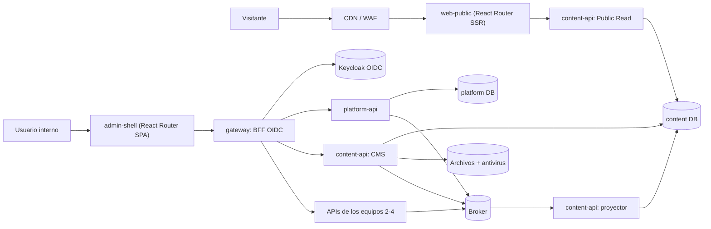

# Spec — Equipo 1: Content & Platform Foundation

> Plataforma de eventos, congresos y convocatorias de IncubaUNAS. Este documento es el prompt y la especificación
> para programar la parte del Equipo 1.
>
> **Fuente:** [event-platform-architecture](https://github.com/juancxdev/event-platform-architecture) (commit `df94d0b`,
> 2026-11-03). **Versión del spec:** 1.3 (2026-11-08): React Router 8 integra todo el frontend (sección 3.7) y las
> APIs arrancan devolviendo mocks (sección 3.8). La 1.2 pasó el sitio público de Astro a React (sección 2); la 1.1
> añadió la sección 3.2, "Todo se conecta mediante APIs".
> **Backlog:** [`backlog.md`](backlog.md).

## 0. Cómo usar este spec

- Es la fuente de verdad para programar la parte del Equipo 1. Si contradice al repositorio de arquitectura, manda la
  arquitectura: primero se corrige el spec y después se escribe código.
- **DEBE / NO DEBE** son obligatorios. **DEBERÍA** admite una excepción justificada en un ADR.
- **Todo se conecta mediante APIs** con contrato: HTTP (OpenAPI) o eventos (AsyncAPI). Nada se integra por base de
  datos compartida ni importando código de otro servicio (sección 3.2).
- Cada requisito tiene un ID para trazarlo en commits, PR y pruebas: `PF-xxx` (historias del backlog canónico), `RN-xx`
  (reglas de negocio), `API-xx` (integración), `FE-xx` (frontend), `MOCK-xx` (mocks), `SEC-xx` (seguridad) y `CAL-xx`
  (calidad).
- Lo marcado **(propuesta)** no está en la arquitectura. Se acuerda con el equipo o con los otros equipos antes de
  implementarlo (sección 13).

### Prompt de arranque

Pega este texto al empezar cada sesión de programación:

```text
Actúa como el equipo de desarrollo del Equipo 1 (Content & Platform Foundation) de la
plataforma de eventos de IncubaUNAS. Programa en TypeScript estricto siguiendo spec.md.

Alcance: SOLO se desarrolla Content & Platform Foundation (sección 1.3). No programes
nada de los equipos 2–5 (eventos, formularios, registros, cupos, tickets, check-in,
correo, reportes, certificados, HukID). Donde necesites algo de ellos, usa sus contratos:
fixtures de eventos validados contra su schema o un servicio de prueba mínimo que solo
existe en las pruebas.

Antes de escribir código:
1. Lee spec.md completo y los documentos de la arquitectura que cite la historia
   (https://github.com/juancxdev/event-platform-architecture; léelos con `gh api`, sin clonar).
2. Ubica la historia en el plan de fases (sección 11). No empieces una fase sin cumplir
   el criterio de salida de la anterior.

Al programar:
3. Todo se conecta mediante APIs con contrato (sección 3.2): los frontends hablan con
   los servicios por HTTP a través del gateway o de la Public Read API; los servicios
   entre sí, por HTTP o eventos. Ningún componente lee ni escribe la base de datos de
   otro, ni importa su código.
4. Contrato primero: cambia el OpenAPI/AsyncAPI/JSON Schema y pasa `pnpm contracts:lint`
   antes del código. Un handler sin operación (o una operación sin handler) es un error.
   Mientras una operación no tenga su caso de uso, responde con su mock (sección 3.8).
   Los frontends usan el cliente tipado generado del contrato, nunca URLs a mano, y leen
   y escriben datos solo con loaders y actions de React Router (sección 3.7).
5. Respeta las capas y los principios SOLID de la sección 3.4; ESLint los hace cumplir.
6. Aplica todas las reglas SEC de la sección 6. Si una historia choca con ellas, detente
   y pregunta.
7. Cada cambio de comportamiento lleva pruebas: dominio, integración con PostgreSQL real,
   contrato y negativas (otro tenant, otro rol, sin sesión).
8. No inventes reglas de dominio de otros equipos ni cambies sus contratos: anótalo en la
   sección 13 y avisa.

Al terminar cada historia:
9. Corre `pnpm check` (debe quedar en verde), actualiza docs/COBERTURA.md y marca el
   ítem en backlog.md.
10. Resume qué quedó hecho, qué quedó pendiente, qué operaciones siguen con mock
    (sección 3.8) y cómo probarlo. Nada simulado se reporta como terminado.
11. El repositorio es público: ningún secreto, token ni dato personal en commits,
    fixtures, logs ni capturas.
```

## 1. Información general

### 1.1 Problema y producto

Hoy una actividad de IncubaUNAS empieza con una publicación en redes y un Google Form. Después se exportan respuestas,
se consolidan listas y la asistencia se marca a mano. La plataforma reemplaza ese flujo por uno digital, trazable y
multiinstitución:

```text
Landing institucional → evento publicado → inscripción/postulación →
confirmación y QR → check-in → reporte básico → certificado PDF
```

El primer cliente es IncubaUNAS; después, facultades y oficinas de la UNAS y otras instituciones.

### 1.2 Los cinco equipos

| Equipo | Producto end-to-end | Responsabilidad principal |
| --- | --- | --- |
| **1. Content & Platform Foundation (nosotros)** | React con React Router para el sitio público, el CMS y el Admin shell (la arquitectura indicaba Astro para el sitio: sección 2); gateway y OIDC | experiencia pública, identidad, tenancy y plataforma compartida |
| 2. Event Configuration | Backoffice de eventos y API de configuración | eventos, agendas simultáneas, formularios y releases publicados |
| 3. Participation | Formulario público, backoffice y API de inscripción | cupos, waitlist, QR, emprendimientos, equipos y postulaciones |
| 4. Onsite Operations | PWA de check-in, workers y operaciones | asistencia, comunicaciones, reportes, certificados y adaptador HukID |
| 5. HukID | Issuer/API Go y wallet Flutter | credenciales verificables independientes de Events |

### 1.3 Qué entrega el Equipo 1

Somos la **ruta crítica**: los equipos 2–4 dependen de nuestro gateway, la librería de autorización, el directorio de
tenants, el design system y la plantilla de CI/CD. La arquitectura recomienda trabajar en dos pares internos:
**Platform** (identidad, gateway, plataforma) y **Experience** (CMS, sitios, shell).

| Entregable | Qué hace | Historias |
| --- | --- | --- |
| `web-public` (React Router, SSR) | Landing comercial, demo, sitios institucionales y páginas de evento. Sirve solo contenido publicado y cacheable | PF-040–043, PF-045, PF-046 |
| `admin-shell` (React Router, SPA) | Shell administrativo (login, organización activa, navegación por permiso) y módulo CMS. Los equipos 2–4 montan sus módulos dentro | PF-044, PF-045, PF-030–038 |
| `gateway` | BFF OIDC (login, sesión, refresh, logout), canje de sesión por token interno, enrutamiento a las APIs de los equipos 1–4, cuotas, CORS y request ID | PF-004, PF-005, PF-023 |
| `platform-api` | Organizaciones, usuarios, membresías, roles, invitaciones, sesiones, service accounts, dominios y auditoría | PF-001–012, PF-020–022, PF-025 |
| `content-api` | CMS (sitios, páginas, medios, tema, navegación, publicaciones), proyector de eventos y Public Read API | PF-030–038, PF-042, PF-046 |
| Paquetes compartidos | `authz` (claims, RBAC, scopes), `tenancy-pg` (RLS), `events` (envelope, outbox, inbox), `http-kit`, `telemetry`, `ui` (design tokens), `api-client` (cliente tipado generado del OpenAPI). Los usan también los equipos 2–4 | PF-024, PF-052, PF-053 |
| Plataforma | Plantilla CI/CD, secretos, broker base, observabilidad, backups y health | PF-050–055 |

### 1.4 Qué no es nuestro

**Este spec es solo para desarrollar Content & Platform Foundation.** Los otros equipos aparecen únicamente como
contratos: lo que nos envían (eventos, manifiestos) y lo que consumen de nosotros (tokens, librería `authz`, gateway,
shell). No se programa nada de su dominio; en las pruebas se usan fixtures validados contra sus schemas o un servicio
de prueba mínimo.

El Equipo 1 **no decide reglas de dominio** de los demás. Entrega identidad, gateway, tenant directory, autorización
compartida, design system y CI/CD; cada servicio autoriza sus propios recursos.

- Eventos, agenda, sedes, ponentes, formularios y releases → Equipo 2. Nosotros solo mostramos el release publicado.
- Registros, cupos, waitlist, tickets, emprendimientos, postulaciones y datos personales de participantes → Equipo 3.
  Nosotros damos el espacio (slot) para su isla React y mostramos disponibilidad orientativa.
- Check-in, comunicaciones (correo), reportes y certificados → Equipo 4.
- HukID → Equipo 5.

### 1.5 Actores

| Actor | Qué hace con nuestra parte | Acceso |
| --- | --- | --- |
| Visitante | Ve landings, catálogo, detalle y agenda | Público, sin cookies privadas |
| Prospecto | Recorre la demo y solicita una demostración | Público, con anti-spam |
| Participante | Llega a la página del evento y abre la isla de registro (Equipo 3) | Sin roles de backoffice |
| Editor (`site_editor`) | Crea sitios, páginas y medios; previsualiza y publica | Sesión + `sites:write`, `sites:publish` |
| Owner (`org_owner`) | Configura la organización, miembros y dominios | Sesión + MFA |
| Security admin | Miembros, sesiones, auditoría y service accounts | Sesión + MFA |
| Platform admin **(propuesta)** | Da de alta y suspende organizaciones (operador de IncubaUNAS) | Rol de plataforma, fuera de los tenants, con MFA |
| Servicio (equipos 2–4) | Valida tokens, consulta capabilities y recibe eventos | Client credentials, audience exacta |
| Operador / soporte | Health, métricas, runbooks y kill switch | Acceso interno autenticado |

### 1.6 Roles y scopes

Los roles vienen del contrato de autorización. Los scopes del token salen de la membresía activa; nadie los asigna a
mano. Permisos = unión de roles menos restricciones por evento o sede. **Denegar es el valor por defecto.**

| Rol | Capacidades (arquitectura) | Scopes del token **(propuesta)** |
| --- | --- | --- |
| `org_owner` | configuración institucional, miembros, dominios y toda capacidad operativa | todos; `reports:export_sensitive` exige además MFA reciente |
| `security_admin` | miembros, sesiones, auditoría y service accounts; no edita contenido | `organizations:admin` (los dominios exigen además el rol `org_owner`) |
| `site_editor` | sitios, CMS, medios y publicación de páginas | `sites:write`, `sites:publish` |
| `event_manager` | eventos, agenda, forms, participantes y comunicaciones | `events:write`, `events:publish`, `participation:read`, `participation:manage`, `communications:send` |
| `application_reviewer` | admisibilidad y postulaciones asignadas; no ve exports globales | `participation:read` (el Equipo 3 restringe a lo asignado) |
| `checkin_staff` | check-in/out en eventos y sedes asignados | `onsite:checkin` |
| `checkin_supervisor` | además registra void y gestiona dispositivos | `onsite:checkin`, `onsite:void` |
| `report_viewer` | dashboards y reportes autorizados | `reports:read` |

## 2. Decisiones técnicas

Estado: **Arquitectura** = lo fija el repositorio de arquitectura · **Equipo** = lo decidió el equipo · **Por defecto**
= lo propone este spec y se cambia con un ADR · **Abierta** = se decide en la sección 13.

| Tema | Decisión | Estado |
| --- | --- | --- |
| Base del frontend | React 19.2 (≥ 19.2.7) + TypeScript; React Router 8 (8.5.1 al escribir esto, fijada en el lockfile); Vite | Equipo / Por defecto |
| Sitio público | React Router en modo framework con SSR sobre Node (adaptador oficial `@react-router/express`). Pre-render de la landing comercial y caché de CDN para el resto (sección 3.7) | Equipo (se aparta de la arquitectura, que indica Astro: ADR-0001 y sección 13) |
| Admin | React Router en modo datos (`createBrowserRouter`): SPA estática servida por el gateway. Los datos entran y salen por loaders y actions, sin TanStack Query. Formularios validados con el mismo JSON Schema del contrato (sección 3.7) | Arquitectura (React) / Por defecto |
| Backend | Node.js 22 LTS (≥ 22.22.0, el mínimo de React Router 8) + TypeScript estricto; Fastify | Equipo / Por defecto |
| Mocks | Las APIs arrancan respondiendo con los ejemplos del contrato y pasan a adaptadores en memoria y luego reales (sección 3.8) | Equipo |
| Base de datos | PostgreSQL 16; una base lógica por servicio (`platform`, `content`); roles separados para migrar y para ejecutar | Arquitectura |
| Acceso a datos | SQL explícito con `pg` + Kysely (tipado); migraciones SQL forward-only | Por defecto |
| Proveedor OIDC | Keycloak en desarrollo y staging, usado solo como OIDC estándar (reemplazable) | Por defecto |
| Gateway | Servicio propio en TypeScript (BFF + proxy), porque debe canjear la sesión por tokens internos con audience exacta. WAF/CDN delante | Por defecto (WAF: Abierta) |
| Broker de eventos | Kafka-compatible; Redpanda en desarrollo, con schema registry | Abierta (propuesta) |
| Caché y cuotas | Redis (o Valkey) | Por defecto |
| Archivos | Almacenamiento S3-compatible (MinIO en desarrollo) + antivirus ClamAV | Por defecto (proveedor: Abierta) |
| Correo | Mailpit en desarrollo; proveedor por definir | Abierta |
| Secretos y KMS | Secret manager por definir; en desarrollo `.env` ignorado por git | Abierta |
| Observabilidad | OpenTelemetry (trazas y métricas); logs JSON con redacción (pino) | Por defecto |
| Contratos | OpenAPI 3.1, AsyncAPI 3.0, JSON Schema 2020-12; lint con Redocly + Spectral; tipos generados desde el contrato | Arquitectura / Por defecto |
| Pruebas | Vitest; PostgreSQL real en Docker; Playwright + axe; k6 | Por defecto |
| Monorepo | pnpm workspaces; versión de Node fijada en `.nvmrc` | Equipo |
| CI/CD | GitHub Actions; SBOM (Syft), escaneo (Trivy), firma (cosign), gitleaks, CODEOWNERS | Por defecto |
| Diseño visual | Lo entrega el integrante de frontend (diseño "Nexus Horizon"); el spec fija comportamiento, datos, seguridad y accesibilidad | Equipo |
| IDs | UUIDv7 generados por la aplicación | Arquitectura |

**Todo el frontend en React con React Router (decisión del equipo, 2026-11-07 y 2026-11-08).** El sitio público, el
shell y el CMS usan React y la misma librería de rutas y datos, React Router 8, cada uno en el modo que le conviene
(sección 3.7). Los componentes de `packages/ui` se comparten entre el sitio y el shell, y el equipo domina una sola
herramienta. Lo que cambia frente a Astro:

- React hidrata la página entera, así que el sitio carga más JavaScript. El presupuesto sube a 120 KB gzip y se mide en
  CI (sección 7.3).
- La hidratación necesita scripts en línea. La CSP los permite solo por hash, porque el HTML se cachea en el CDN y un
  nonce quedaría repetido entre visitantes (SEC-13).
- La isla de registro del Equipo 3 ya era React: pasa a ser un componente que el sitio carga de forma diferida
  (sección 13, #4).

Next.js queda como alternativa. No se eligió porque su caché propia (ISR y caché de datos) se superpone con la del CDN
por surrogate key (PF-046), y con React Router los dos frontends comparten la misma forma de cargar datos.

## 3. Arquitectura

### 3.1 Vista de componentes



`content-api` se despliega como tres procesos con el mismo código y distinto privilegio:

- **cms**: escribe borradores y publicaciones.
- **projector**: consume eventos y escribe proyecciones.
- **public-read**: solo lee proyecciones y publicaciones, con un rol de base de datos de solo lectura.

Así, una campaña que satura la lectura pública no toca la edición, y un fallo de la lectura pública no puede escribir
nada.

### 3.2 Todo se conecta mediante APIs

**Principio:** cada componente expone sus datos y capacidades solo a través de una API con contrato, y consume los de
los demás solo a través de las suyas. No hay bases de datos compartidas, ni archivos compartidos, ni código de un
servicio importado por otro.

"API" abarca dos formas, y las dos tienen contrato versionado, ejemplos y pruebas:

- **HTTP (síncrona):** contrato OpenAPI 3.1. Se usa para pedir o cambiar algo y esperar la respuesta.
- **Eventos (asíncrona):** contrato AsyncAPI 3.0. La arquitectura la exige para propagar cambios entre servicios (por
  ejemplo, un release publicado o la disponibilidad), para que una visita pública no dependa de otro servicio (AD-2,
  AD-5, AD-6).

#### Mapa de conexiones

| Desde | Hacia | Cómo | Contrato | Autenticación |
| --- | --- | --- | --- | --- |
| Navegador (sitio público) | `web-public` | HTTP (páginas) | — | Ninguna |
| `web-public` (loaders de React Router en el servidor) | `content-api` Public Read | HTTP `/public/v1` | `public.yaml` | Pública, solo lectura |
| Isla de registro (navegador) | API de Participation (Equipo 3) | HTTP a través del gateway | Contrato del Equipo 3 | Pública, con cuotas y challenge |
| `admin-shell` y módulo CMS | `platform-api`, `content-api` | HTTP `/platform/v1`, `/cms/v1` a través del gateway | `platform.yaml`, `cms.yaml` | Cookie de sesión + CSRF; el gateway emite el token interno |
| Módulos de los equipos 2–4 dentro del shell | Sus propias APIs | HTTP a través del gateway | Contrato de cada equipo | Cookie de sesión + CSRF; el gateway emite el token interno |
| `gateway` | Keycloak | OIDC (HTTP) | Estándar OIDC | Client confidencial + PKCE |
| `gateway` | `platform-api` | HTTP interno (sesiones, membresías) | `platform.yaml` (operaciones internas) | Token de servicio (mTLS en producción) |
| APIs de los equipos 2–4 | `gateway` | HTTP: JWKS y emisión de tokens de servicio | `auth.yaml` | Pública (JWKS) o client credentials |
| APIs de los equipos 2–4 | `platform-api` | HTTP: capabilities y resolución de tenant | `platform.yaml` | Token de servicio |
| `platform-api`, `content-api` | Broker | Eventos publicados desde el outbox | `asyncapi/team1.yaml` | ACL por topic |
| Equipos 2 y 3 | `content-api` (proyector) | Eventos al inbox + HTTP para descargar el manifiesto | AsyncAPI de cada equipo | ACL por topic + token de servicio |
| `content-api` | Almacenamiento de objetos | API S3 con URL firmada | — | Credencial del servicio |
| `content-api` | CDN | API de purga | — | Credencial del servicio |

#### Reglas

- **API-01** Ningún servicio lee ni escribe la base de datos de otro: ni foreign keys, ni consultas SQL, ni vistas
  compartidas. Cada servicio tiene sus propias credenciales de base de datos (AD-5).
- **API-02** Los frontends (`web-public`, `admin-shell` y los módulos montados en él) nunca se conectan a una base de
  datos ni a un servicio interno directamente: solo al gateway o a la Public Read API.
- **API-03** Toda API se define primero en `contracts/` (OpenAPI o AsyncAPI). El contrato es la fuente de los tipos, los
  validadores, los clientes y la documentación.
- **API-04** Los frontends usan el cliente tipado generado del OpenAPI (`packages/api-client`). No hay `fetch` con URLs
  escritas a mano.
- **API-05** Las APIs se versionan en la ruta (`/v1`) y los topics en el nombre (`.v1`). Un cambio incompatible crea
  `/v2` o `.v2` y convive con la versión anterior al menos 90 días. La deprecación se anuncia con los headers
  `Deprecation` y `Sunset` **(propuesta)**.
- **API-06** Toda llamada entre servicios lleva autenticación, `X-Request-Id` y `traceparent`. Además tiene timeout y
  circuit breaker, y solo se reintenta (con backoff) si es idempotente **(por defecto)**.
- **API-07** Una visita pública no encadena llamadas: la Public Read API responde desde su proyección. Los datos de
  otros equipos llegan por eventos, no consultando sus APIs en cada visita (AD-2).
- **API-08** Las librerías compartidas no acceden a datos de nadie. Por ejemplo, `authz` obtiene las claves públicas del
  JWKS por HTTP y las guarda en caché.
- **API-09** Cada API tiene documentación navegable generada del contrato (Redoc en desarrollo) y un ejemplo válido por
  operación.
- **API-10** Entre equipos solo hay contratos. Los otros equipos usan nuestros paquetes públicos (`authz`, `events`,
  `http-kit`, `ui`, `api-client`), pero no importan código de nuestros servicios, y nosotros no importamos el suyo.

Los módulos de los equipos 2–4 se montan en el shell como paquetes versionados que exportan sus rutas de React Router y
las capabilities que exigen (FE-07) **(propuesta)**. El shell solo les entrega un cliente HTTP autenticado por la cookie
de sesión, nunca tokens; cada módulo habla con su propia API a través del gateway.

### 3.3 Estructura del repositorio

```text
apps/
  web-public/        React Router, modo framework (SSR + pre-render): landing comercial, demo, sitios y páginas de evento
  admin-shell/       React Router, modo datos (SPA): shell + módulo CMS
services/
  gateway/           BFF OIDC + proxy + emisor de tokens internos
  platform-api/      identidad, tenants, membresías, dominios, auditoría
  content-api/       CMS + proyector + Public Read API
packages/
  shared-kernel/     tipos base: errores de dominio, UUIDv7, reloj
  authz/             claims, roles, scopes y verificación de tokens (lo usan los equipos 2–4)
  tenancy-pg/        withTenant (SET LOCAL) y utilidades de RLS
  events/            envelope, outbox relay, inbox, puerto EventBus
  http-kit/          Problem Details, idempotencia, ETag/If-Match, request ID, paginación, mock de contrato (3.8)
  telemetry/         OpenTelemetry + logger con redacción
  ui/                design tokens y componentes base
  api-client/        cliente HTTP tipado, generado del OpenAPI (lo usan los frontends)
contracts/
  openapi/           auth.yaml, platform.yaml, cms.yaml, public.yaml
  asyncapi/          team1.yaml
  schemas/           events/*.json, blocks/*.json
  examples/          ejemplos por operación y respuesta: los usan el mock, las pruebas y la documentación
  docs/              documentación navegable generada (Redoc)
docker/              compose de desarrollo (PostgreSQL, Keycloak, Redis, Redpanda, MinIO, ClamAV, Mailpit)
docs/                adr/, runbooks/, COBERTURA.md
```

Archivos de la raíz desde el primer commit: `.gitattributes` (`* text=auto eol=lf`), `.editorconfig`, `.nvmrc`,
`.env.example`, `CODEOWNERS` y `CLAUDE.md` con las reglas de trabajo.

### 3.4 Capas (arquitectura hexagonal) y SOLID

Cada servicio se organiza en capas. Las fronteras las verifica ESLint en CI.

| Capa | Contiene | Puede importar | No puede |
| --- | --- | --- | --- |
| `domain/` | Entidades, value objects, máquinas de estado y errores de dominio | `shared-kernel` | I/O, frameworks, `pg`, `fastify`, `process.env`, `Date.now()` |
| `application/` | Casos de uso (uno por comando o consulta) y puertos (`ports.ts`) | `domain`, `shared-kernel` | Adaptadores, frameworks, SQL |
| `infrastructure/` | Adaptadores de los puertos: PostgreSQL, Keycloak, S3, Redis, broker, y los de memoria (sección 3.8) | Capas anteriores + librerías | `interfaces/` |
| `interfaces/http/` | Handlers por `operationId`, validación con el OpenAPI, mapeo a casos de uso y a Problem Details | `application` | Lógica de negocio, SQL |
| Raíz de composición | `app.ts` y `main.ts`: el único lugar que instancia y conecta todo | Todo | — |

Cómo se aplica SOLID en este código:

- **S (responsabilidad única):** un caso de uso por comando; un handler solo traduce HTTP a caso de uso; un agregado
  por módulo.
- **O (abierto/cerrado):** los bloques del CMS son un registro `tipo → JSON Schema + renderizador`. Añadir un bloque no
  toca el núcleo. Las políticas de autorización se componen (rol ∪ scope − restricción).
- **L (sustitución):** cada puerto tiene una suite de contrato que pasan todas sus implementaciones (memoria y
  PostgreSQL). Un adaptador que no la pasa no se integra.
- **I (segregación de interfaces):** puertos pequeños según la necesidad (`PageReader`, `PageWriter`,
  `PublicationStore`), no un repositorio genérico.
- **D (inversión de dependencias):** `application` depende de interfaces. La regla de fronteras de ESLint bloquea
  importar `pg`, `fastify` o SDKs en `domain` y `application`.

### 3.5 Multi-tenancy

- Toda tabla con datos de un tenant tiene `organization_id NOT NULL`, RLS con `FORCE ROW LEVEL SECURITY`, una política
  por `current_setting('app.organization_id')` y un índice que empieza por `organization_id`. Una prueba de CI falla si
  falta cualquiera de los tres.
- El rol de ejecución es `NOBYPASSRLS` y no es dueño de las tablas. Las migraciones corren con otro rol.
- El tenant se fija con `SET LOCAL` dentro de la transacción (`withTenant(orgId, fn)`), solo con claims ya validados, y
  se limpia al devolver la conexión al pool.
- La Public Read API usa un rol de solo lectura sobre las tablas de proyección y publicación.
- Los datos globales sin tenant (slug de organización, hostname, `(issuer, subject)`) se resuelven con una función
  privilegiada mínima que devuelve solo IDs opacos (PF-022).

### 3.6 Flujos principales

**A. Inicio de sesión (BFF).**

1. `GET /auth/login?return_to=` valida el destino contra la allowlist. Genera `state`, `nonce` y el verificador PKCE
   del lado del servidor (TTL 10 min, un uso) y redirige al IdP.
2. El IdP autentica. La contraseña, el MFA y la recuperación viven en el IdP.
3. `GET /auth/callback` valida `state`, `nonce`, PKCE, issuer y audience. Vincula `(issuer, sub)` al usuario, crea la
   sesión (ID opaco en la cookie y su hash en la base de datos) y redirige al destino.
4. El middleware de la ruta raíz del shell pide `GET /platform/v1/me` y arma la navegación con las capabilities
   (FE-06).

**B. Llamada a una API (propia o de otro equipo).**

1. El navegador llama al gateway con la cookie y el token CSRF.
2. El gateway valida la sesión (inactividad y vigencia absoluta) y carga la membresía activa. La caché de esa consulta
   dura como máximo 60 s, para cumplir el plazo de revocación.
3. El gateway emite un token interno firmado: `aud` exacta del servicio destino, TTL de 5 minutos y los claims de la
   sección 9.9. Lo reenvía junto con `X-Request-Id` y `traceparent`.
4. El servicio valida la firma (JWKS), `aud`, `exp` y los scopes, y fija el tenant con `withTenant`.

Nunca se reenvía el token del IdP a otro servicio.

**C. Publicar una página.**

1. El editor guarda el borrador con `PATCH` e `If-Match`.
2. `POST …/publications` (con `Idempotency-Key` y `expected_revision`) abre una transacción que:
   - crea el snapshot inmutable con su hash y versión;
   - pasa la publicación anterior a `superseded`;
   - escribe `content.page.published.v1` en el outbox.
3. El relay publica el evento y purga el CDN por surrogate key. La purga se reintenta si falla.

**D. Consumir un release del Equipo 2.**

1. El inbox deduplica por `domain_event_id`.
2. El proyector descarga el manifiesto por `manifest_ref` y verifica `manifest_hash`.
3. Materializa la proyección en `pending`: evento, agenda, programas y estado de inscripción.
4. Cuando están todos los artefactos requeridos, la activa de forma atómica (`active`; la anterior pasa a
   `superseded`) y purga la caché.

`aggregate.version` ordena los mensajes y las versiones viejas se ignoran. Si algo falla, la proyección pasa a
`failed` y salta una alerta; un replay la devuelve a `pending`.

**E. Resolver host y slug.** Un middleware de servidor de `web-public` (sección 3.7) recibe el host y llama a la resolución
de sitio (PF-022). Recibe IDs opacos y el slug canónico, y los deja en el contexto de React Router para los loaders. Un
host desconocido responde un 404 genérico.

### 3.7 Frontend con React Router

Los dos frontends usan React Router 8, cada uno en el modo que le conviene. Las APIs que cita esta sección (`loader`,
`action`, `middleware`, `headers`, `prerender`, `createRoutesStub`) son las de la versión 8 y se revisan contra la
documentación oficial antes de cada actualización mayor.

| Aspecto | `web-public` | `admin-shell` |
| --- | --- | --- |
| Modo | Framework (`@react-router/dev` sobre Vite), `ssr: true` | Datos: `createBrowserRouter` y `RouterProvider` (de `react-router/dom`), compilado con Vite |
| Dónde corre | Servidor Node con `@react-router/express`; la landing comercial se pre-renderiza en el build (`prerender`) | Navegador: archivos estáticos que sirve el gateway, en el mismo origen que la API |
| Rutas | `app/routes.ts`, con tipos generados (`+types`) y `href()` para los enlaces | Árbol de `RouteObject` del shell más las rutas que exporta cada módulo |
| Lectura | `loader` en el servidor, con el `api-client`, contra la Public Read API | `loader` en el navegador, con el `api-client`, contra el gateway |
| Escritura | Solo la solicitud de demo (PF-040); su destino lo fija el acuerdo de la sección 13, #6 | `action` con `<Form>` o `useFetcher` |
| Middleware | De servidor: resuelve el host al sitio (flujo E) y lo deja en el contexto (`createContext`) | De cliente: carga la sesión en la ruta raíz y exige la capability de cada ruta |
| Caché | `headers` de cada ruta: `Cache-Control` y `Surrogate-Key` | Ninguna en el CDN; los loaders se revalidan después de cada `action` |
| Errores | `ErrorBoundary` por ruta: 404, evento cancelado y error genérico sin detalles internos | `ErrorBoundary` por ruta y por módulo: Problem Details, sin acceso y conflicto `412` |

- **FE-01** Una sola capa de rutas y datos: React Router. No se añade otra (TanStack Query, SWR, Redux) sin un ADR, ni
  se usan las APIs marcadas `unstable_`.
- **FE-02** Los loaders y las actions solo llaman al `api-client` (API-04) y traducen Problem Details a datos,
  redirecciones o errores de la ruta. No contienen reglas de negocio (CAL-05).
- **FE-03** Ningún componente llama a una API: lee con `useLoaderData` y escribe con `<Form>` o `useFetcher`. Después de
  cada `action`, React Router revalida los loaders de la página.
- **FE-04** `web-public`: `entry.server.tsx` espera a que la página esté completa (`onAllReady`, sin streaming), calcula
  el hash `sha256` de cada script en línea y envía la CSP (SEC-13). Las páginas pre-renderizadas llevan los hashes que
  calcula el build, y el servidor los envía como header. El servidor no crea sesiones ni pone cookies.
- **FE-05** `web-public`: cada ruta fija su caché con `headers`: `Cache-Control` público y `Surrogate-Key` para el
  contenido publicado; `no-store` y `noindex` para la vista previa (PF-033, PF-046).
- **FE-06** `admin-shell`: el middleware de cliente de la ruta raíz carga la sesión (`/platform/v1/me`) y, si no hay
  sesión, lleva al login. Cada ruta declara en `handle` la capability que exige; sin ella muestra "sin acceso" y no llama
  a su API. Esto es solo experiencia de uso: la autorización real la hacen el gateway y cada API (sección 6.2).
- **FE-07** Montaje de módulos (el CMS y los de los equipos 2–4): cada módulo es un paquete versionado que exporta
  `routes` (`RouteObject[]` con `lazy`) y su manifiesto de navegación con capabilities. El shell los monta bajo
  `/o/{slug}/{módulo}` sin conocer su código. `react-router` es peer dependency, con la misma versión mayor que el shell
  **(propuesta, sección 13, #16)**.
- **FE-08** Código dividido por ruta: `lazy` en el shell y la división automática del modo framework en el sitio. La isla
  del Equipo 3 se carga solo en el navegador (sección 13, #4).
- **FE-09** Cada ruta se prueba con `createRoutesStub` (con datos, con error y sin permiso), y los journeys con
  Playwright sobre el build real (sección 7.2).

### 3.8 APIs con mocks (etapa inicial)

Para que el frontend y los equipos 2–4 avancen sin esperar al backend, todas las APIs del Equipo 1 responden desde el
Sprint 0, primero con mocks. Cada operación pasa por tres estados, y `docs/COBERTURA.md` registra en cuál está:

| Estado | Qué responde | Qué ya es real | Dónde se permite |
| --- | --- | --- | --- |
| `example` | El ejemplo del contrato para esa operación (`contracts/examples/`) | Ruta, validación del request y del response contra el OpenAPI, Problem Details y request ID | Local y CI |
| `memory` | El caso de uso real sobre adaptadores en memoria, cargados con los mismos ejemplos | Además: dominio, casos de uso, scopes y eventos en el `EventBus` en memoria | Local y CI |
| `real` | El caso de uso con PostgreSQL, Keycloak, broker, MinIO y ClamAV | Todo | Todos los entornos |

`web-public` y el shell se construyen contra estas APIs en mock por el mismo camino que usarán en producción
(`api-client`, gateway y Public Read API), así que no cambian cuando la operación pasa a `real`.

- **MOCK-01** Toda operación del OpenAPI responde desde el Sprint 0. Si todavía no tiene caso de uso, la atiende el mock
  de contrato de `http-kit`: devuelve el ejemplo de su respuesta por defecto, y el header `Prefer: example=<nombre>`
  elige otro ejemplo, por ejemplo un error **(por defecto)**.
- **MOCK-02** El mock sale del contrato, no se inventa: cada ejemplo valida contra el schema de su respuesta en CI, y las
  pruebas de contrato (sección 7.2) corren igual en `example`, `memory` y `real`.
- **MOCK-03** El estado `memory` usa los adaptadores en memoria de los puertos (sección 3.4, principio L). Los casos de
  uso, los handlers y los frontends no saben qué adaptador hay detrás: lo decide la raíz de composición con
  `DATA_SOURCE=memory|real`. Al reiniciar, los datos vuelven a los ejemplos.
- **MOCK-04** Los mocks se ven: toda respuesta que no viene de `real` lleva `X-Mock: example` o `X-Mock: memory`, y el
  health `ready` informa el estado de cada operación.
- **MOCK-05** Sesión de prueba: mientras el login BFF no esté hecho (Fase 1), el gateway ofrece en local una sesión fija
  con un usuario ficticio del seed y el rol que indique `MOCK_ROLE`. Con ella emite el token interno igual que en
  producción, firmado con una clave de desarrollo, así que `authz` y los scopes se prueban desde el principio.
- **MOCK-06** Solo en local y CI: con `APP_ENV=staging` o `production`, un servicio no arranca si tiene una operación sin
  caso de uso, `DATA_SOURCE=memory` o la sesión de prueba. La imagen de producción no incluye el mock de contrato, los
  adaptadores en memoria ni la sesión de prueba, y la CI lo comprueba.
- **MOCK-07** Un mock no es trabajo terminado: una historia está hecha solo cuando sus operaciones están en `real`, y
  ninguna fase cierra su criterio de salida con mocks en sus historias (sección 11). Los ejemplos usan datos ficticios:
  el repositorio es público.

## 4. Requerimientos funcionales

Historias del backlog canónico del Equipo 1 (40). Los criterios están en forma verificable. La columna **Corte** sigue
el corte MVP de `BACKLOG-INDEX.md`; los cortes que no fija el índice son **(propuesta)**.

### 4.1 PF-A — Organizaciones, identidad y acceso

| ID | Historia | Criterios de aceptación | Corte |
| --- | --- | --- | --- |
| PF-001 | Crear organización y su primer owner | Alta idempotente (`Idempotency-Key`). Slug DNS-safe y único global. Owner `active` con MFA exigido. Auditoría. Si falla un paso del provisioning se compensa: la organización pasa de `provisioning` a `active` solo al final. Emite `platform.organization.lifecycle_changed.v1`. | MVP |
| PF-002 | Invitar un miembro con roles | Exige `organizations:admin` y MFA reciente. Roles de la allowlist. Vence en 7 días como máximo. Un solo uso. Token aleatorio de 128 bits o más, guardado solo como hash. No duplica una membresía activa ni una invitación pendiente (409). El correo sale por evento (sección 13). La respuesta nunca incluye el token. | MVP |
| PF-003 | Aceptar o rechazar la invitación | Aceptar exige sesión OIDC con correo verificado igual al invitado. Estados `pending → accepted/declined/expired/revoked`. Reusar el enlace → 409. Vencida → 409 `invitation_expired`. La ruta con token se redacta en logs y trazas. | MVP |
| PF-004 | Iniciar sesión con OIDC + PKCE | Valida `state`, `nonce`, PKCE S256, issuer y audience. Cookie `HttpOnly; Secure; SameSite=Lax`. `return_to` de una allowlist exacta (si no está, va al inicio). Audita éxitos y fallos. | MVP |
| PF-005 | Mantener y cerrar la sesión de forma segura | Cada refresh rota el ID. Reutilizar uno rotado revoca la familia en menos de 60 s. Inactividad 8 h, vigencia absoluta 30 d. Logout revoca y limpia la cookie aunque falle el logout federado. Logout global exige MFA reciente. Ningún token en `localStorage` ni `sessionStorage`. | MVP |
| PF-006 | Respuesta clara si estoy bloqueado o sin membresía | 401 sin sesión. 403 con identidad válida sin permiso. 404 para un recurso de otro tenant. Pantalla "sin acceso" sin cargar datos privados. Audita las denegaciones sensibles. | MVP |
| PF-007 | Recuperar acceso o configurar MFA en el IdP | Enlaces al flujo del IdP con retorno de la allowlist. `org_owner` y `security_admin` no ejecutan acciones privilegiadas sin MFA (`amr`). Autenticación reciente de 10 minutos como máximo para miembros, dominios, claves y exports. | MVP |
| PF-008 | Cambiar roles, suspender o revocar miembros | `If-Match` (412 si cambió). La organización nunca queda sin owner activo (409 `last_owner`). Suspender revoca las sesiones afectadas en menos de 60 s. Emite `platform.membership.changed.v1`. | MVP |
| PF-009 | Cambiar de organización | Solo membresías activas. Reemite sesión y claims con el nuevo tenant. Cachés privadas separadas por organización. La URL del shell lleva la organización (`/o/{slug}/…`). | MVP |
| PF-010 | Consultar y revocar sesiones activas | Lista con dispositivo, IP seudonimizada (HMAC), último uso y marca de la sesión actual. Revocación inmediata. Nunca expone tokens ni IDs de refresh. | MVP **(propuesta)** |
| PF-011 | Service accounts con scopes mínimos | Exige `security_admin` y MFA. Secreto mostrado una sola vez, o `private_key_jwt`. Solo se guarda el hash o una referencia KMS. Expiración, rotación con solapamiento y revocación inmediata. Audience exacta. | MVP **(propuesta)**: los equipos 2–4 la necesitan |
| PF-012 | Consultar eventos de identidad y autorización | Append-only: el rol de ejecución no puede hacer UPDATE ni DELETE. Filtros por actor, acción y fecha con cursor. Retención de 2 años. El export exige scope y MFA. Sin tokens ni claims personales. | MVP: escritura · Posterior: consulta y export **(propuesta)** |

### 4.2 PF-B — Tenant, dominios y gateway

| ID | Historia | Criterios de aceptación | Corte |
| --- | --- | --- | --- |
| PF-020 | Configurar nombre, zona horaria, locale y estado | Validaciones (zona IANA, locale BCP 47). Revisión optimista con `If-Match`. Una organización suspendida bloquea lo privado y conserva lo público según la política. | MVP |
| PF-021 | Asociar y verificar un dominio | Challenge DNS TXT o HTTP. Hostname único global. TLS automático. Prevención de takeover: reverificación periódica y suspensión si el dominio deja de apuntar. Alerta de renovación. | MVP |
| PF-022 | Resolver host y slug sin fuga entre tenants | Resolución privilegiada mínima. Host y slug canonizados (minúsculas, sin puerto, IDN a punycode, sin punto final). Devuelve solo IDs opacos. Pruebas negativas: host ajeno, slug de otro tenant, mayúsculas, punto final. | MVP |
| PF-023 | Gateway común | Valida sesión o JWT y audience. Rate limit por IP, sesión y client. CORS con allowlist. Límites de tamaño y timeouts. `X-Request-Id` y `traceparent`. Errores como Problem Details. WAF delante (sección 13). | MVP |
| PF-024 | Librería común de tenant y RBAC | Solo lee claims validados. Fija RLS. Helpers de scope, evento y sitio. Se publica como paquete versionado con pruebas contractuales para los equipos 2–4. | MVP (Fase 0) |
| PF-025 | Bloquear una organización o client comprometido | Kill switch auditable. Revoca sesiones y clients. La caché de la decisión dura como máximo 60 s. Runbook. | MVP **(propuesta)** |

### 4.3 PF-C — CMS y medios

| ID | Historia | Criterios de aceptación | Corte |
| --- | --- | --- | --- |
| PF-030 | Crear y configurar un sitio | Tipo `product`, `demo` o `client`. Tema, locale y navegación. Solo dentro de su organización. Nace en borrador. | MVP |
| PF-031 | Crear, editar y ordenar páginas con bloques tipados | Cada bloque valida contra su JSON Schema versionado. No se acepta HTML libre. Texto enriquecido sanitizado. `If-Match`. Autosave con control de conflicto (el 412 se ve en la UI). Errores con JSON Pointer. | MVP |
| PF-032 | Subir imágenes y documentos | URL de subida firmada y corta. Límite de tamaño, MIME de una allowlist (sin SVG) y hash. Antivirus. Estados `pending → scanning → ready/quarantined`; solo `ready` se sirve. Una imagen pública exige texto alternativo. | MVP |
| PF-033 | Previsualizar sin publicar | Token de 15 minutos como máximo, de un uso y ligado al usuario. `Cache-Control: no-store` y `X-Robots-Tag: noindex`. El borrador nunca es accesible públicamente. | MVP |
| PF-034 | Publicar una versión inmutable | Snapshot, hash y versión. Publicación idempotente. Emite `content.page.published.v1`. Purga del CDN. El borrador posterior queda separado de lo publicado. | MVP |
| PF-035 | Restaurar una versión previa como publicación nueva | Historial y comparación. Restaurar crea una publicación nueva; el snapshot viejo nunca cambia. Auditoría. | Posterior **(propuesta)** |
| PF-036 | Configurar SEO y redes | title, description, canonical, Open Graph, imagen, sitemap y robots, con valores por defecto accesibles. Vista previa. | Posterior (en MVP: title, description, canonical) |
| PF-037 | Insertar catálogo, evento destacado y agenda sin duplicar eventos | El bloque guarda un filtro o un ID más la publication, no una copia del evento. Solo muestra releases activas. Estados vacío y de error. | MVP |
| PF-038 | Versionar tema y navegación | Tokens de una allowlist. Contraste AA validado. Enlaces solo relativos o `https:`. Vista previa, publicación y rollback. | MVP (tokens básicos) · Posterior (temas avanzados) |

### 4.4 PF-D — Frontends públicos y Admin Shell

| ID | Historia | Criterios de aceptación | Corte |
| --- | --- | --- | --- |
| PF-040 | Entender el producto y solicitar una demo | Landing rápida y accesible, pre-renderizada. Formulario con anti-spam (honeypot, challenge y rate limit) y consentimiento explícito. Confirmación y evento interno. Dónde se guardan los datos del prospecto: sección 13. | MVP |
| PF-041 | Recorrer una demo reproducible | Seed sin datos personales, con un evento simple y una convocatoria. Reset versionado: el mismo comando deja siempre el mismo estado. Banner "Demo" en todas las páginas. | MVP |
| PF-042 | Consultar sitio, catálogo, detalle y programas | SSR o estático en el edge. Release coherente: todo de la misma `publication_id`. 404 y evento cancelado. Locale y zona horaria del evento. SEO. Ninguna llamada transaccional en cache hit. | MVP |
| PF-043 | Iniciar el registro desde la página del evento | Slot estable para la isla React del Equipo 3. CSP sin orígenes ajenos. Design tokens. Analítica solo con consentimiento. Si la isla falla, se muestra un mensaje y un enlace alternativo. | MVP |
| PF-044 | Shell administrativo consistente | Callback de login, organización activa, navegación según permisos y breadcrumbs. Estados cargando, vacío, error y sin acceso. Logout. Los módulos de los equipos 2–4 se montan sin modificar el shell. | MVP |
| PF-045 | Interfaces accesibles y responsive | WCAG 2.2 AA en los journeys críticos. Teclado, foco visible y lector de pantalla. Pruebas en escritorio y móvil. Respeta `prefers-reduced-motion`. | MVP |
| PF-046 | Contenido actualizado sin cruces de caché | Clave `host/site/locale/slug/publication_id`. `ETag` y `Surrogate-Key`. Nunca cachea respuestas con cookie ni de vista previa. Purga versionada. | MVP |

### 4.5 PF-E — Plataforma operable

| ID | Historia | Criterios de aceptación | Corte |
| --- | --- | --- | --- |
| PF-050 | Plantilla de repositorio y pipeline | Lint, pruebas, SBOM, escaneo, build, firma y deploy. Ambientes aislados. Promoción y rollback. CODEOWNERS. | MVP |
| PF-051 | Secretos y configuración seguros | Secret manager con rotación. Ningún secreto en logs ni en el build. Configuración tipada y validada al arrancar: si falta algo, el servicio no arranca. | MVP |
| PF-052 | Métricas, logs y trazas comunes | OpenTelemetry. IDs de request, traza y organización. Redacción de datos personales. Dashboards, alertas y SLO. Correlación entre servicios. | MVP |
| PF-053 | Broker, registro de schemas, retry y DLQ | ACL por topic. Compatibilidad validada. Retención de 7 días. Replay controlado. DLQ restringida y sin datos personales. | MVP |
| PF-054 | Backups y recuperación del tenant y el CMS | PITR. Cifrado. Simulacro de restauración con RPO y RTO medidos. Runbook y evidencia trimestral. | MVP antes de producción |
| PF-055 | Health, readiness y diagnóstico seguro | `live` y `ready` separados, con dependencias diferenciadas. Sin secretos. Apagado con drenaje. Estado interno autenticado. | MVP |

## 5. Reglas de negocio

| ID | Regla | Origen |
| --- | --- | --- |
| RN-01 | El slug de organización tiene 3–63 caracteres (`a-z`, `0-9` y guion, sin guion al inicio ni al final) y es único global | API, DB |
| RN-02 | Siempre hay al menos un `org_owner` activo: el último no se revoca, suspende ni degrada | STATE |
| RN-03 | Una invitación vence en 7 días como máximo, se usa una vez y su token se guarda solo como hash. No hay dos pendientes para el mismo correo y organización | API, AUTH |
| RN-04 | Los roles solo pueden ser los de la sección 1.6. Los scopes salen de la membresía activa | AUTH |
| RN-05 | El tenant y el actor salen del token o la sesión. Un `organization_id` en el cuerpo, un header o la query se rechaza (422) | AUTH, API |
| RN-06 | Denegar por defecto. Permisos = unión de roles − restricciones | AUTH |
| RN-07 | Un recurso de otro tenant responde 404 (no 403) para no revelar que existe | AUTH |
| RN-08 | Sesión: inactividad 8 h, vigencia absoluta 30 d. La autenticación reciente para acciones privilegiadas vale 10 minutos como máximo | AUTH |
| RN-09 | Reutilizar un refresh ya rotado revoca toda la familia en menos de 60 s | AUTH |
| RN-10 | Suspender un usuario, membresía u organización invalida la autorización y las sesiones afectadas en menos de 60 s | AUTH |
| RN-11 | `org_owner` y `security_admin` necesitan MFA para tocar miembros, dominios, claves y exports sensibles | AUTH |
| RN-12 | Las redirecciones solo van a una allowlist exacta: sin comodines ni prefijos | AUTH |
| RN-13 | Una publicación es inmutable; restaurar crea otra. Cada página tiene una sola publicación vigente | STATE, DB |
| RN-14 | Un release de evento solo se ve completo. Hay uno solo activo por evento y los anteriores quedan `superseded` | ARCH (AD-6) |
| RN-15 | La disponibilidad que muestra Content es orientativa y lleva su `as_of`. Quien decide el cupo es Participation | MICRO |
| RN-16 | Un hostname es único global y solo sirve tráfico en estado `active` (verificado) | DB, STATE |
| RN-17 | Un medio solo se sirve en `ready`. Una imagen pública exige texto alternativo | T1 backlog |
| RN-18 | Los tokens de tema salen de una allowlist con contraste AA. Los enlaces de navegación solo pueden ser relativos o `https:` | T1 backlog |
| RN-19 | Content no guarda datos personales ni respuestas de formularios, solo datos públicos | ARCH (AD-8) |
| RN-20 | Una visita pública no llama a otros servicios: solo lee proyecciones | ARCH (AD-2) |
| RN-21 | La eliminación física nunca reemplaza un estado de negocio. Toda transición no listada responde 409 `invalid_state_transition` | STATE |
| RN-22 | Una `Idempotency-Key` se guarda al menos 24 h. Misma clave y mismo cuerpo repiten la respuesta; misma clave y otro cuerpo → 409 | API |
| RN-23 | La auditoría es append-only y se conserva 2 años | DATA |
| RN-24 | Retención por defecto: versiones 2 años, medios retirados 30 días, invitaciones 7 días, membresías mientras dure el contrato + 2 años | DATA |

Origen: AUTH = `AUTH-AND-AUTHORIZATION-CONTRACT.md` · API = `contracts/API-CONTRACTS.md` · STATE =
`contracts/STATE-MACHINES.md` · DB = `contracts/DATABASE-BOUNDARIES-AND-MIGRATIONS.md` · DATA =
`contracts/DATA-OWNERSHIP-AND-RETENTION.md` · ARCH = `ARCHITECTURE-SPINE.md` · MICRO = `MICROSERVICES-ARCHITECTURE.md`.

## 6. Seguridad

Todas las reglas SEC son obligatorias. Cada una tiene al menos una prueba automatizada (sección 6.7).

### 6.1 Identidad y sesión

- **SEC-01** La plataforma nunca ve ni guarda contraseñas. La recuperación y el MFA viven en el IdP.
- **SEC-02** La cookie de sesión `__Host-sid` lleva solo un ID opaco aleatorio de 256 bits o más, con
  `HttpOnly; Secure; SameSite=Lax; Path=/`. En la base de datos se guarda su hash SHA-256.
- **SEC-03** `state`, `nonce` y el verificador PKCE se guardan del lado del servidor, duran 10 minutos como máximo y se
  usan una vez.
- **SEC-04** CSRF: toda petición con cookie que cambie estado (POST, PUT, PATCH, DELETE) exige un token CSRF y un
  `Origin` de la allowlist.
- **SEC-05** Los tokens internos se firman con clave asimétrica (ES256 o EdDSA) con `kid` rotable. Se publica el JWKS.
  Duran 5 minutos como máximo y llevan la `aud` exacta del servicio destino. Nunca se reenvía el token del IdP.
- **SEC-06** Todos los endpoints de autenticación responden `Cache-Control: no-store` y nunca registran códigos, tokens
  ni cookies.

### 6.2 Autorización y tenant

- **SEC-07** Cada operación declara su scope (y su rol, si aplica) en el OpenAPI con la extensión `x-required-scope`
  **(propuesta)**. La librería `authz` lo aplica antes del caso de uso; una operación sin declaración impide arrancar.
- **SEC-08** RLS forzada en toda tabla de tenant, con una prueba de dos tenants sobre el mismo pool en CI.
- **SEC-09** La matriz rol × acción × recurso está automatizada con pruebas negativas: otro tenant, otro rol, sin
  sesión, token con otra audience y token vencido.
- **SEC-10** Los secretos de service accounts se guardan solo como hash (argon2id) o referencia KMS y se muestran una vez.

### 6.3 Entradas, salidas y navegador

- **SEC-11** Toda entrada se valida contra el OpenAPI o el JSON Schema, con `additionalProperties: false`. Cuerpo JSON de
  1 MB como máximo **(por defecto)**.
- **SEC-12** El contenido del CMS se guarda como bloques tipados y no se acepta HTML. El texto enriquecido se renderiza
  con allowlist y escapado. Los enlaces solo pueden ser relativos o `https:`.
- **SEC-13** CSP estricta en `web-public` y `admin-shell`:
  - `default-src 'self'`, sin `unsafe-inline` ni `unsafe-eval`;
  - `object-src 'none'`, `base-uri 'none'` y `frame-ancestors 'none'`;
  - `connect-src` solo a orígenes propios.

  Sin manejadores `on*` en línea. Fuentes e imágenes autoalojadas. `admin-shell` no tiene ningún script en línea: en
  modo datos, su `index.html` solo carga módulos externos. En `web-public`, los únicos scripts en línea son los de
  hidratación que genera React Router, y la CSP los permite por su hash `sha256`, calculado en cada render (o en el
  build, para las páginas pre-renderizadas; FE-04). No se usa nonce, aunque es lo que sugiere la guía de React Router: el
  HTML se cachea en el CDN y el nonce se repetiría entre visitantes. Por eso las páginas públicas se renderizan completas
  antes de responder, sin streaming **(por defecto)**.
- **SEC-14** Cabeceras:
  - HSTS, con preload en producción;
  - `X-Content-Type-Options: nosniff`;
  - `Referrer-Policy: strict-origin-when-cross-origin`, y `no-referrer` en rutas con token;
  - `Permissions-Policy` mínima.
- **SEC-15** CORS solo para los orígenes de la allowlist; nunca `*` con credenciales.
- **SEC-16** Rate limit, con valores iniciales ajustables **(por defecto)**. Al superarlo se responde 429 con
  `Retry-After`.

  | Ruta | Límite |
  | --- | --- |
  | Login | 10/min por IP |
  | Invitaciones | 20/h por organización |
  | Formulario de demo | 5/h por IP |
  | API privada | 300/min por sesión |

### 6.4 Archivos y dominios

- **SEC-17** Las subidas van directo al almacenamiento con una URL firmada de 5 minutos como máximo, que fija tamaño y
  tipo. Al completarlas se verifican el hash y el tipo real (magic bytes) y se pasa el antivirus; solo entonces el
  archivo pasa a `ready`. No se aceptan SVG ni HTML **(por defecto)**.
- **SEC-18** Los medios se sirven desde un origen distinto al de la aplicación, con `nosniff` y
  `Content-Disposition: attachment` en los documentos.
- **SEC-19** La verificación HTTP de dominios está protegida contra SSRF: sin redirecciones, timeout corto, y se
  rechazan IP privadas, loopback y link-local después de resolver el DNS.
- **SEC-20** Takeover: los dominios se reverifican periódicamente. Si uno deja de apuntar, pasa a `suspended` y no sirve
  contenido.

### 6.5 Datos personales, logs y auditoría

- **SEC-21** Logs en JSON con redacción de:
  - las cabeceras `authorization`, `cookie` y `set-cookie`;
  - tokens y correos;
  - rutas que llevan un token.

  Nunca hay datos personales en métricas, trazas, eventos ni DLQ.
- **SEC-22** La IP en auditoría y sesiones se seudonimiza con HMAC y una clave rotable.
- **SEC-23** La auditoría es append-only y registra actor, organización, acción, objetivo opaco, resultado y
  `request_id`. El rol de ejecución solo puede hacer INSERT y SELECT.
- **SEC-24** Los errores no revelan si existe un correo, un usuario o un recurso de otro tenant.

### 6.6 Cadena de suministro y secretos

- **SEC-25** El repositorio es público: `.env` está ignorado y `.env.example` solo lleva valores de desarrollo.
  gitleaks escanea secretos en pre-commit y en CI.
- **SEC-26** Las dependencias se fijan con lockfile. Se auditan con `pnpm audit` y Trivy, y se actualizan con
  Renovate o Dependabot. Las imágenes llevan SBOM y firma.
- **SEC-27** Las imágenes de contenedor corren sin root, con sistema de archivos de solo lectura y sin herramientas
  innecesarias.
- **SEC-28** La configuración es tipada y se valida al arrancar: si falta un secreto o un valor es inválido, el servicio
  no arranca.

### 6.7 Amenazas, controles y pruebas

| Amenaza | Control | Prueba automatizada |
| --- | --- | --- |
| Acceso a datos de otra organización | Tenant desde claims + RLS forzada + 404 | Prueba de dos tenants y negativas en cada endpoint |
| Robo de sesión por XSS | Cookie HttpOnly, CSP estricta, sin HTML libre en el CMS | CSP del sitio compilado; payloads XSS en bloques |
| CSRF | SameSite=Lax + token CSRF + `Origin` | POST sin token → 403 |
| Open redirect | Allowlist exacta de `return_to` | `return_to=https://evil.example` → termina en `/` |
| Reutilización de refresh | Rotación + revocación de la familia | Reusar el anterior → familia revocada |
| Escalada de privilegios | Roles de allowlist, MFA y autenticación reciente, último owner protegido | Cambiar un rol sin MFA → 403; quitar al último owner → 409 |
| Subida maliciosa | URL firmada, magic bytes, antivirus, cuarentena, origen separado | Archivo EICAR → `quarantined` y nunca se sirve |
| Takeover de dominio | Challenge, reverificación y suspensión | Dominio que deja de apuntar → `suspended` |
| SSRF en la verificación | Sin redirecciones, IP privadas bloqueadas | Host que resuelve a 127.0.0.1 → falla |
| Envenenamiento de caché | Clave con host/site/locale/slug/publication, sin cookies | Mismo slug en dos hosts → contenidos distintos |
| Fuga de datos en logs | Redacción | Busca correos y tokens en los logs de las pruebas |

## 7. Calidad y buenas prácticas

### 7.1 Código

- **CAL-01** TypeScript `strict`, con `noUncheckedIndexedAccess` y `exactOptionalPropertyTypes`. `any` está prohibido
  por lint.
- **CAL-02** ESLint y Prettier en CI, con reglas de fronteras de capas (sección 3.4).
- **CAL-03** Código en inglés. Textos de la UI en español, preparados para i18n (`es-PE` por defecto).
- **CAL-04** Los errores de dominio son tipados y se traducen a Problem Details en un solo lugar.
- **CAL-05** No hay lógica de negocio en handlers, componentes React ni loaders o actions de React Router, ni SQL fuera
  de los adaptadores.
- **CAL-06** Funciones y archivos pequeños. Complejidad ciclomática de 10 como máximo por función **(por defecto)**.
- **CAL-07** Toda decisión que cambie el spec o la arquitectura lleva un ADR en `docs/adr/`.

### 7.2 Pruebas

| Tipo | Qué cubre | Herramienta | Mínimo |
| --- | --- | --- | --- |
| Unitarias de dominio | Invariantes, máquinas de estado y reglas | Vitest | Toda transición válida e inválida |
| Integración | Casos de uso con PostgreSQL real, RLS, outbox e inbox | Vitest + PostgreSQL | Cada caso de uso; prueba de dos tenants |
| Contrato de API | Request y response de cada operación validados contra el OpenAPI, en mock y en real (MOCK-02) | Vitest + Ajv | 100 % de las operaciones, con un camino de error |
| Contrato de eventos | Ejemplo válido, productor ↔ consumidor, duplicado y replay | Vitest + JSON Schema | 100 % de los topics propios y consumidos |
| Puertos | Suite común que pasa cada adaptador | Vitest | Todas las implementaciones |
| Rutas del frontend | Loader, action, error y permiso de cada ruta | Vitest + `createRoutesStub` | Cada ruta: con datos, con error y sin permiso (FE-09) |
| Seguridad | Negativas de autorización, CSRF, redirect, XSS, CSP, SSRF | Vitest + Playwright | Matriz completa (sección 6.7) |
| End-to-end | Login → shell → publicar una página → verla en el sitio | Playwright | Journeys críticos |
| Accesibilidad | axe en páginas públicas y en el shell | Playwright + axe | 0 violaciones serias o críticas |
| Humo del build | Sitio compilado bajo su CSP real | Playwright | En cada PR |
| Carga | Sitio público y gateway | k6 | 3× el pico esperado antes de producción |

Cobertura de 90 % de líneas y ramas en `domain/` y `application/` **(por defecto)**; la cobertura sin aserciones no
cuenta. Las pruebas son deterministas: el reloj y el generador de IDs se inyectan, y no hay `sleep`.

### 7.3 Rendimiento y disponibilidad

| Indicador | Objetivo | Origen |
| --- | --- | --- |
| p95 público desde la región objetivo | < 500 ms | Arquitectura |
| Disponibilidad de la Content Read API | 99,9 % mensual | Arquitectura |
| Lecturas transaccionales en cache hit | Ninguna | Arquitectura |
| Sobrecarga p95 del gateway | < 50 ms | Por defecto |
| LCP del sitio público en móvil 4G | < 2,5 s | Por defecto |
| JavaScript inicial del sitio público (con React, sin la isla) | < 120 KB gzip, medido en CI; se recalibra en el Sprint 0 con el esqueleto | Por defecto |

### 7.4 Accesibilidad

WCAG 2.2 AA. Contraste validado, foco visible, landmarks, formularios con etiquetas y errores asociados, navegación con
teclado y `prefers-reduced-motion`.

### 7.5 Observabilidad y operación

- Métricas RED (tasa, errores, duración) por endpoint, pool de base de datos, lag del outbox y de las proyecciones, DLQ
  y tasa de aciertos de caché.
- Trazas OpenTelemetry de extremo a extremo.
- Logs JSON con `request_id`, `trace_id` y `organization_id`.
- Dashboard y alertas por servicio, y un runbook en `docs/runbooks/`.

### 7.6 Flujo de trabajo

- Ramas cortas con el ID de la historia (`feat/PF-031-bloques`). `main` está protegida: no se hace push directo y la CI
  en verde es obligatoria.
- PR pequeños, de menos de 400 líneas de diff **(por defecto)**, con revisión de al menos un integrante según
  CODEOWNERS.
- Commits con Conventional Commits que citan el ID (`feat(cms): PF-031 valida bloques por schema`).

### 7.7 Definition of Done

Basada en la DoD común de la arquitectura más las reglas de este spec:

- [ ] OpenAPI/AsyncAPI actualizado y versionado antes de integrar; `pnpm contracts:lint` en verde.
- [ ] Toda conexión nueva pasa por una API con contrato (sección 3.2); los frontends usan `api-client`.
- [ ] Las pruebas de la sección 7.2 que apliquen, incluidas las negativas de autorización y tenant.
- [ ] Migraciones forward-only con RLS, política e índice que empieza por el tenant.
- [ ] Idempotencia en los comandos e inbox en los consumidores.
- [ ] Métricas, trazas y logs sin datos personales ni tokens.
- [ ] Accesibilidad verificada si la historia toca UI.
- [ ] `docs/COBERTURA.md` actualizado: hecho, parcial o pendiente, y el estado de cada operación (`example`, `memory` o
  `real`).
- [ ] Las operaciones de la historia están en `real`: con un mock, la historia no está hecha (MOCK-07).
- [ ] Runbook y dashboard mínimo si es un servicio nuevo.
- [ ] PR revisado y aprobado; `pnpm check` en verde.

## 8. Criterios de aceptación — BDD / Gherkin

```gherkin
# language: es
Característica: Sesión segura con OIDC (PF-004, PF-005)

  Escenario: Inicio de sesión con destino permitido
    Dado que "/o/incubaunas/cms" está en la allowlist de destinos
    Cuando visito "/auth/login?return_to=/o/incubaunas/cms" y me autentico en el IdP
    Entonces el callback valida state, nonce, PKCE, issuer y audience
    Y recibo la cookie "__Host-sid" con HttpOnly, Secure y SameSite=Lax
    Y termino en "/o/incubaunas/cms"
    Y queda una auditoría "login.succeeded" sin tokens

  Escenario: Destino externo no permitido
    Cuando visito "/auth/login?return_to=https://evil.example" y me autentico
    Entonces termino en "/"
    Y queda una auditoría "login.redirect_rejected"

  Escenario: Reutilización de un refresh ya rotado
    Dado que mi sesión ya rotó su identificador
    Cuando alguien presenta el identificador anterior
    Entonces la respuesta es 401
    Y toda la familia de la sesión queda revocada en menos de 60 segundos
```

```gherkin
# language: es
Característica: Aislamiento entre organizaciones (PF-006, PF-024)

  Escenario: Recurso de otra organización
    Dado que soy "site_editor" de "incubaunas"
    Y la página "P" pertenece a "facultad-agronomia"
    Cuando pido GET "/cms/v1/pages/P"
    Entonces la respuesta es 404 con Problem Details
    Y la respuesta no revela que la página existe
    Y queda una auditoría de acceso denegado con el objetivo opaco

  Escenario: Rol sin permiso
    Dado que soy "report_viewer" de "incubaunas"
    Cuando intento POST "/cms/v1/pages/P/publications"
    Entonces la respuesta es 403 sin datos personales

  Escenario: Organización enviada en el cuerpo
    Dado que soy "site_editor" de "incubaunas"
    Cuando creo un sitio enviando "organization_id" en el cuerpo
    Entonces la respuesta es 422 con un error en el pointer "/organization_id"
```

```gherkin
# language: es
Característica: Membresías (PF-002, PF-003, PF-008)

  Escenario: No se puede quitar al último owner
    Dado que "ana" es la única "org_owner" activa de "incubaunas"
    Cuando se intenta cambiar su rol a "site_editor"
    Entonces la respuesta es 409 con code "last_owner"
    Y su membresía no cambia

  Escenario: Invitación aceptada una sola vez
    Dado una invitación pendiente para "luis@example.org" con rol "site_editor"
    Cuando "luis@example.org" inicia sesión con correo verificado y la acepta
    Entonces su membresía queda "active" con rol "site_editor"
    Cuando alguien vuelve a usar el mismo enlace
    Entonces la respuesta es 409 y no se crea otra membresía

  Escenario: Invitación vencida
    Dado una invitación creada hace 8 días que vencía a los 7
    Cuando el invitado intenta aceptarla
    Entonces la respuesta es 409 con code "invitation_expired"

  Escenario: Cambio de rol sin autenticación reciente
    Dado que soy "org_owner" y mi última autenticación con MFA fue hace 30 minutos
    Cuando intento cambiar el rol de un miembro
    Entonces la respuesta es 403 con code "recent_auth_required"
    Y el shell me lleva a reautenticarme en el IdP
```

```gherkin
# language: es
Característica: Edición y publicación de páginas (PF-031, PF-033, PF-034)

  Escenario: Edición con una revisión vieja
    Dado que la página "P" está en la revisión 4
    Cuando envío PATCH con "If-Match" de la revisión 3
    Entonces la respuesta es 412 con code "stale_revision"

  Escenario: Bloque con HTML
    Cuando guardo un bloque de texto con "<script>alert(1)</script>"
    Entonces la respuesta es 422 con un error en el pointer "/blocks/0/text"

  Escenario: Publicación idempotente
    Dado que publiqué la página "P" con la clave "K"
    Cuando repito la misma petición con la clave "K"
    Entonces recibo la misma respuesta y no se crea otra versión
    Cuando uso la clave "K" con otro cuerpo
    Entonces la respuesta es 409 con code "idempotency_key_reused"

  Escenario: Vista previa de un solo uso
    Dado un token de vista previa recién creado para la página "P"
    Cuando lo abro
    Entonces veo el borrador con "Cache-Control: no-store" y "X-Robots-Tag: noindex"
    Cuando lo abro por segunda vez
    Entonces la respuesta es 404
```

```gherkin
# language: es
Característica: Proyección pública de eventos (PF-037, PF-042, PF-046)

  Escenario: Un release incompleto no se publica
    Dado que llega "configuration.event.release_published.v1" con un manifiesto de 4 artefactos
    Y solo se materializaron 3
    Entonces el release queda "pending" y el sitio sigue mostrando el release anterior
    Cuando se materializa el cuarto artefacto
    Entonces el release pasa a "active" de forma atómica
    Y el anterior pasa a "superseded" y se purga la caché

  Escenario: Mensaje duplicado
    Dado que ya procesé el evento con "domain_event_id" "E1"
    Cuando llega otra vez con otro "message_id"
    Entonces no cambia nada y el consumidor responde éxito

  Escenario: Caché sin cruces entre sitios
    Dado dos sitios de organizaciones distintas que tienen la página "/eventos"
    Cuando pido "/eventos" en el host de cada uno
    Entonces cada respuesta trae el contenido de su sitio y su propia "Surrogate-Key"
    Y ninguna respuesta pública lleva "Set-Cookie"
```

```gherkin
# language: es
Característica: Medios, gateway y suspensión (PF-032, PF-023, PF-025)

  Escenario: Archivo infectado
    Dado que subo un archivo con la firma de prueba EICAR
    Cuando termina el escaneo
    Entonces el medio queda "quarantined"
    Y ninguna URL pública lo sirve

  Escenario: Token con audience equivocada
    Dado un token interno válido con "aud" "content-api"
    Cuando se presenta a "platform-api"
    Entonces la respuesta es 401

  Escenario: Exceso de peticiones
    Cuando una IP supera el límite de "/auth/login"
    Entonces la respuesta es 429 con "Retry-After"

  Escenario: Organización suspendida
    Dado que la organización "X" se suspende
    Entonces en menos de 60 segundos sus sesiones dejan de autorizar operaciones privadas
    Y su sitio público sigue disponible según la política
```

## 9. Diseño de API y eventos

### 9.1 Convenciones

- Prefijos: `/auth/*` (gateway), `/platform/v1/*`, `/cms/v1/*` y `/public/v1/*`. Las rutas del catálogo que vienen sin
  prefijo (`/organizations/{id}/memberships`, `/pages/{id}`…) se publican bajo el prefijo de su API **(propuesta)**.
- JSON en `snake_case`, fechas UTC RFC 3339, IDs UUIDv7 y cursores opacos. Colecciones `{ "items": [], "next_cursor":
  null }` con límite de 1 a 100.
- POST de comando: `Idempotency-Key` obligatorio (16–128 caracteres) y retenido al menos 24 h.
- PATCH y comandos que dependen de la revisión: `If-Match` obligatorio y respuesta con `ETag`. Si no coincide → 412
  `stale_revision`; si falta → 428 **(propuesta)**. PATCH usa JSON Merge Patch (`application/merge-patch+json`).
- Errores en `application/problem+json`: `type`, `title`, `status`, `code`, `detail`, `request_id` y `errors[]` con
  `pointer`.
- `X-Request-Id` se acepta si es válido y si no se regenera; siempre se devuelve. `traceparent` W3C. `Retry-After` en
  429 y 503.
- Respuestas privadas con `Cache-Control: no-store`. Públicas con `ETag`, `Cache-Control`, `Vary` y `Surrogate-Key`.
- Todo recurso mutable devuelve `id`, `organization_id`, `state`, `revision`, `created_at` y `updated_at`.
- Un 202 solo se responde con un recurso de operación consultable.

### 9.2 Auth BFF (gateway)

| Método y ruta | Auth | Efecto |
| --- | --- | --- |
| `GET /auth/login?return_to=` | Público | Crea state/nonce/PKCE del lado del servidor y redirige al IdP |
| `GET /auth/callback` | Cookie de state | Valida y crea la sesión, o devuelve Problem Details |
| `POST /auth/refresh` | Cookie + CSRF | Rota la familia; cookie nueva; `204` |
| `POST /auth/logout` | CSRF | Revoca la sesión y limpia la cookie; idempotente |
| `POST /auth/logout-all` | Sesión + MFA reciente | Revoca todas las familias del usuario |
| `GET /platform/v1/me` | Sesión | Identidad, organización activa, roles, capabilities y `auth_time` |
| `GET /platform/v1/me/capabilities` | Sesión | Permisos efectivos y restricciones (recurso opcional) |
| `GET /platform/v1/me/sessions` | Sesión | Sesiones enmascaradas; nunca refresh ni tokens |
| `DELETE /platform/v1/me/sessions/{id}` | Titular o admin | Revoca la sesión o familia |

### 9.3 Platform API

| Método y ruta | Auth | Entrada | Efecto |
| --- | --- | --- | --- |
| `POST /platform/v1/organizations` | Platform admin | slug, legal_name, display_name, timezone, locale, owner_identity | Organización + membresía owner |
| `GET /platform/v1/organizations/{id}` | Miembro | — | Configuración + `ETag` |
| `PATCH /platform/v1/organizations/{id}` | `organizations:admin` + `If-Match` | Merge patch | Organización actualizada |
| `POST /platform/v1/organizations/{id}/suspensions` | Platform admin | reason | Suspende el tenant y sus sesiones |
| `GET /platform/v1/organizations/{id}/memberships` | `organizations:admin` | Filtros y cursor | Miembros, roles y estado |
| `POST /platform/v1/organizations/{id}/invitations` | `organizations:admin` + MFA reciente | email, roles, expires_at | Invitación `pending` |
| `POST /public/v1/invitations/{token}/acceptance` | Sesión OIDC + token | — | Membresía `active` |
| `POST /public/v1/invitations/{token}/declination` | Token | — | Invitación `declined` |
| `PATCH /platform/v1/memberships/{id}` | `organizations:admin` + MFA reciente + `If-Match` | roles, status | Roles o suspensión; revoca sesiones si aplica |
| `GET /platform/v1/me/organizations` | Sesión | — | Membresías activas |
| `POST /platform/v1/session-context` | Sesión | organization_id | Rota el contexto de la sesión |
| `POST /platform/v1/organizations/{id}/service-accounts` | `security_admin` + MFA reciente | auth_method, scopes, audiences, expires_at | Client + secreto mostrado una vez |
| `POST /platform/v1/service-accounts/{id}/rotations` | `security_admin` + MFA reciente | Nueva clave, expiración | Credencial nueva con solapamiento |
| `POST /platform/v1/service-accounts/{id}/revocations` | `security_admin` | reason | Revocación inmediata |
| `POST /platform/v1/sites/{id}/domains` | `org_owner` + MFA reciente | hostname | Challenge de verificación |
| `POST /platform/v1/domains/{id}/verifications` | `org_owner` | — | `active` o `failed`; TLS |

`POST /platform/v1/session-context` recibe `organization_id` porque es la organización a la que se quiere cambiar. Solo
se acepta si el usuario tiene una membresía activa ahí; no es una forma de elegir el tenant de otra operación.

### 9.4 CMS API

| Método y ruta | Auth | Entrada | Efecto |
| --- | --- | --- | --- |
| `POST /cms/v1/sites` | `sites:write` | slug, name, kind, locale | Sitio en borrador |
| `GET /cms/v1/sites/{id}` | `sites:write` | — | Configuración + `ETag` |
| `PATCH /cms/v1/sites/{id}` | `sites:write` | Merge patch + `If-Match` | Sitio actualizado |
| `POST /cms/v1/sites/{id}/pages` | `sites:write` | path, title, blocks | Página en borrador |
| `GET /cms/v1/pages/{id}` | `sites:write` | — | Borrador y revisión |
| `PATCH /cms/v1/pages/{id}` | `sites:write` | Merge patch + `If-Match` | Revisión nueva |
| `POST /cms/v1/pages/{id}/preview-tokens` | `sites:write` | ttl | URL de vista previa corta y de un uso |
| `POST /cms/v1/pages/{id}/publications` | `sites:publish` | expected_revision | Versión inmutable + evento |
| `POST /cms/v1/pages/{id}/restorations` | `sites:publish` | source_publication_id | Publicación nueva basada en otra |
| `POST /cms/v1/media-uploads` | `sites:write` | name, mime, size, sha256 | URL de subida + medio `pending` |
| `POST /cms/v1/media/{id}/completion` | Usuario o servicio | Metadatos del objeto | `scanning`, luego `ready` o `quarantined` |

### 9.5 Public Read API

| Método y ruta | Entrada | Efecto |
| --- | --- | --- |
| `GET /public/v1/sites/{slug}` | host, locale | Snapshot del sitio + `ETag` |
| `GET /public/v1/sites/{slug}/pages/{path}` | — | Página publicada, cacheable |
| `GET /public/v1/sites/{slug}/events` | Filtros y cursor | Catálogo proyectado |
| `GET /public/v1/sites/{slug}/events/{event_slug}` | — | Release público coherente |

Las respuestas públicas llevan `ETag`, `Cache-Control: public, max-age=60, stale-while-revalidate=300`
**(por defecto)** y `Surrogate-Key` con `site:{id}`, `page:{id}`, `publication:{id}` y `event:{id}` según corresponda.
Nunca llevan `Set-Cookie`.

### 9.6 Adiciones propuestas al catálogo

Hacen falta para cumplir las historias y no están en el catálogo. El catálogo exige revisar el ownership de todo
endpoint que no incluye, así que **se registran antes de implementarlas**.

| Ruta | Para qué |
| --- | --- |
| `GET /.well-known/jwks.json` (gateway) | Claves públicas de los tokens internos |
| `POST /oauth/token` (gateway, `client_credentials` o `private_key_jwt`) | Tokens de service accounts (PF-011) |
| `GET /platform/v1/roles` | Catálogo de roles (el backlog nombra `/roles`) |
| `GET /platform/v1/organizations/{id}/invitations` | Listar invitaciones (PF-002) |
| `POST /platform/v1/invitations/{id}/revocations` | Revocar una invitación pendiente |
| `POST /platform/v1/organizations/{id}/reactivations` | Volver de `suspended` a `active` |
| `GET /platform/v1/organizations/{id}/sessions` | Sesiones de los miembros (PF-010) |
| `GET /platform/v1/organizations/{id}/service-accounts` | Listar service accounts |
| `GET /platform/v1/sites/{id}/domains` | Listar dominios |
| `GET /platform/v1/organizations/{id}/audit-events` | Consultar auditoría (PF-012) |
| `GET /cms/v1/sites`, `GET /cms/v1/sites/{id}/pages` | Listados del CMS |
| `GET /cms/v1/pages/{id}/publications` | Historial (PF-035) |
| `GET /cms/v1/media` | Biblioteca de medios |
| `PUT /cms/v1/sites/{id}/theme`, `PUT /cms/v1/sites/{id}/navigation` | Tema y navegación versionados (PF-038) |
| `GET /public/v1/site-resolutions?host=` | Resolver host → sitio (PF-022) |
| `GET /public/v1/previews/{token}` | Leer una vista previa (PF-033) |
| `GET /public/v1/sites/{slug}/pages` | Rutas publicadas, para el sitemap |
| `POST /public/v1/sites/{slug}/leads` | Solicitud de demo (PF-040) |
| `GET /health/live`, `GET /health/ready` (cada servicio) | PF-055 |

### 9.7 Errores

Códigos estables del catálogo que usa el Equipo 1:

| Code | Status | Cuándo |
| --- | --- | --- |
| `invalid_state_transition` | 409 | Transición que no está en la máquina de estados |
| `stale_revision` | 412 | `If-Match` no coincide |
| `tenant_forbidden` | 403 | Organización suspendida o contexto inválido |
| `idempotency_key_reused` | 409 | Misma clave con otro cuerpo |
| `invitation_expired` | 409 | Invitación vencida |
| `publication_incomplete` | 409 | Release o publicación sin todos sus artefactos |
| `release_gap` | 409 | Falta una versión intermedia de un release |
| `file_not_ready` | 409 | Medio que aún no está `ready` |
| `file_quarantined` | 409 | Medio en cuarentena |

Códigos **(propuesta)** para registrar en el catálogo: `validation_failed` (422), `last_owner` (409), `slug_taken`
(409), `hostname_taken` (409), `mfa_required` (403), `recent_auth_required` (403) y `preview_expired` (404).

### 9.8 Eventos

**Producidos por el Equipo 1:**

| Topic | Consumidores | Payload mínimo, sin datos personales |
| --- | --- | --- |
| `platform.organization.lifecycle_changed.v1` | Equipos 2–4 | organization, previous/current state, effective_at |
| `platform.membership.changed.v1` | Auditoría, cachés auth | membership, usuario opaco, hash de roles/scopes, state |
| `platform.domain.activated.v1` | Content/CDN | site, hostname, primary, activated_at |
| `content.page.published.v1` | CDN, auditoría | site, page, publication, path, locale, content_hash |

**Consumidos por el Equipo 1** (el catálogo de eventos nos lista en los tres de configuración, aunque el backlog solo
nombra dos):

| Topic | Productor | Uso |
| --- | --- | --- |
| `configuration.event.release_published.v1` | Equipo 2 | Materializar el release `pending → active` (flujo D) |
| `configuration.event.cancelled.v1` | Equipo 2 | Mostrar el evento como cancelado |
| `configuration.schedule.changed.v1` | Equipo 2 | Actualizar la agenda pública |
| `participation.availability.changed.v1` | Equipo 3 | Disponibilidad orientativa con `as_of` |

Reglas: outbox en la misma transacción que el cambio; inbox con `(consumer_name, domain_event_id)` único; el duplicado
devuelve éxito; un mensaje venenoso va a la DLQ sin datos personales; el replay conserva `domain_event_id` y
`occurred_at`. Cambios aditivos en la misma versión; lo incompatible crea `.v2` con 90 días de convivencia.

### 9.9 Ejemplos

Problem Details:

```json
{
  "type": "https://errors.example.pe/stale-revision",
  "title": "Stale revision",
  "status": 412,
  "code": "stale_revision",
  "detail": "La página cambió desde que la abriste. Recarga y vuelve a aplicar tus cambios.",
  "request_id": "01933f5e-8c2a-7b4e-9a10-3c5d7e9f1a2b",
  "errors": []
}
```

Claims del token interno (contrato de autorización + `iss`, `auth_time` y `jti`):

```json
{
  "iss": "https://gateway.example.pe",
  "sub": "8f14e45f-ea2c-4b6e-9b1a-1c2d3e4f5a6b",
  "sid": "01933f5e-9d3b-7a01-8c22-4b5c6d7e8f90",
  "organization_id": "01933f40-1a2b-7c3d-8e4f-5a6b7c8d9e0f",
  "membership_id": "01933f41-2b3c-7d4e-9f50-6b7c8d9e0f1a",
  "roles": ["site_editor"],
  "scopes": ["sites:write", "sites:publish"],
  "aud": "content-api",
  "amr": ["pwd", "mfa"],
  "auth_time": 1794063000,
  "iat": 1794063300,
  "exp": 1794063600,
  "jti": "01933f5f-0a1b-7c2d-8e3f-4a5b6c7d8e9f"
}
```

Envelope de `content.page.published.v1`:

```json
{
  "message_id": "01933f60-1b2c-7d3e-8f4a-5b6c7d8e9f0a",
  "domain_event_id": "01933f60-1b2c-7d3e-9a5b-6c7d8e9f0a1b",
  "topic": "content.page.published.v1",
  "schema_version": 1,
  "producer": "content",
  "organization_id": "01933f40-1a2b-7c3d-8e4f-5a6b7c8d9e0f",
  "business_event_id": null,
  "occurred_at": "2026-11-07T15:00:00Z",
  "published_at": "2026-11-07T15:00:01Z",
  "actor": { "type": "user", "id": "01933f41-2b3c-7d4e-9f50-6b7c8d9e0f1a" },
  "traceparent": "00-4bf92f3577b34da6a3ce929d0e0e4736-00f067aa0ba902b7-01",
  "correlation_id": "01933f5e-8c2a-7b4e-9a10-3c5d7e9f1a2b",
  "causation_id": "01933f5e-8c2a-7b4e-9a10-3c5d7e9f1a2b",
  "aggregate": { "type": "page", "id": "01933f50-3c4d-7e5f-8a6b-7c8d9e0f1a2b", "version": 3 },
  "partition_key": "01933f40-1a2b-7c3d-8e4f-5a6b7c8d9e0f:01933f50-3c4d-7e5f-8a6b-7c8d9e0f1a2b",
  "data": {
    "site_id": "01933f45-4d5e-7f6a-9b7c-8d9e0f1a2b3c",
    "page_id": "01933f50-3c4d-7e5f-8a6b-7c8d9e0f1a2b",
    "publication_id": "01933f60-0a1b-7c2d-8e3f-4a5b6c7d8e9f",
    "path": "/guia",
    "locale": "es-PE",
    "content_hash": "sha256:9f2c4e1a7b3d5f6e8a0c2b4d6f8e0a1c3b5d7f9e1a3c5b7d9f1e3a5c7b9d1f3e"
  }
}
```

`business_event_id: null` y la `partition_key` por agregado son **(propuesta)** para eventos que no pertenecen a un
evento de negocio (sección 13).

## 10. Datos y estados

### 10.1 Tablas

Columnas comunes a toda tabla de tenant: `id uuid` (UUIDv7 de la aplicación), `organization_id uuid not null`,
`revision bigint not null default 1`, `created_at`, `updated_at`, `created_by` y `updated_by`. El servidor fija los
tiempos. Los estados son `text` con un check constraint, no enums de PostgreSQL. No hay foreign keys hacia bases de
otros servicios: las referencias externas son UUID opacos con versión o hash cuando importa.

| Base | Tablas | Constraints críticas |
| --- | --- | --- |
| `platform` | `organizations`, `users`, `identities`, `memberships`, `membership_roles`, `invitations`, `sessions`, `refresh_families`, `service_accounts`, `service_credentials`, `domains`, `security_audit`, `idempotency_keys`, `outbox` | Únicos: `(issuer, subject)`, slug y hostname globales. Un owner activo como mínimo (constraint o trigger transaccional). Tokens y secretos solo como hash. |
| `content` | `sites`, `site_themes`, `navigations`, `pages`, `page_drafts`, `page_publications`, `media_assets`, `event_projections`, `availability_projections`, `projection_releases`, `idempotency_keys`, `inbox`, `outbox` | Únicos: `(organization_id, slug)` y `(site_id, path, locale)`. Publicación inmutable. Un release activo por evento. |

- **Outbox:** `domain_event_id`, aggregate y versión, topic y schema, payload, `occurred_at` y `published_at`,
  intentos y lease.
- **Inbox:** `(consumer_name, domain_event_id)` único, procesado, hash del resultado y metadatos de error.
- **Idempotencia:** `(organization_id, actor o client, operation, key)` único, hash del request, referencia a la
  respuesta y expiración.

Migraciones: expand → deploy compatible → backfill → validate → switch → contract. No hay down migrations destructivas
en producción.

### 10.2 Máquinas de estado

| Agregado | Estados | Transiciones válidas |
| --- | --- | --- |
| Organization | provisioning, active, suspended, archived | provisioning→active; active⇄suspended; active/suspended→archived |
| Membership | invited, active, suspended, revoked, expired | invited→active/expired/revoked; active⇄suspended; active/suspended→revoked |
| Invitation **(propuesta)** | pending, accepted, declined, expired, revoked | pending→accepted/declined/expired/revoked |
| Domain | pending, verifying, active, failed, suspended, released | pending→verifying→active/failed; active⇄suspended; suspended→released |
| Page publication | draft, published, superseded | draft→published; published→superseded. Restaurar crea una publicación nueva |
| Projection release | pending, active, failed, superseded | pending→active/failed; active→superseded; failed→pending (replay) |
| Media asset **(propuesta)** | pending, scanning, ready, quarantined, retired | pending→scanning; scanning→ready/quarantined; ready/quarantined→retired |
| Session **(propuesta)** | active, revoked, expired | active→revoked/expired |

La invitación y la membresía se mueven juntas: al invitar se crea la membresía en `invited`. Aceptar la pasa a `active`;
rechazar o revocar la pasa a `revoked`; vencer la pasa a `expired`. Así se respeta la máquina de Membership de la
arquitectura y los estados de invitación de PF-003.

### 10.3 Retención

| Dato | Retención por defecto |
| --- | --- |
| Sesión | Inactividad 8 h; vigencia absoluta 30 d |
| Invitación | 7 d |
| Auditoría | 2 años |
| Membresía | Mientras dure el contrato + 2 años |
| Versiones publicadas | 2 años |
| Medios retirados | 30 d |
| Caché pública | Según headers |

Son valores técnicos por defecto: UNAS/IncubaUNAS debe ratificarlos antes de producción.

## 11. Plan de entrega por fases

Cada fase termina con una demo y un criterio de salida verificable. Las fases 1 y 3 son del par **Platform**; las 2 y
4, del par **Experience**, y pueden avanzar en paralelo. La fase 2 necesita el contrato del Equipo 2. Desde la Fase 0
todas las operaciones responden con mock (sección 3.8); cada fase las pasa a `real` y no cierra con mocks en sus
historias (MOCK-07).

| Fase | Nombre | Sprint de la arquitectura |
| --- | --- | --- |
| 0 | Cimientos | Sprint 0 |
| 1 | Identidad y acceso | Sprint 1 |
| 2 | CMS y sitio público | Sprint 1 (Gate público) y Sprint 2 |
| 3 | Administración de la organización | Sprint 2 |
| 4 | Dominios, medios y landing comercial | Sprint 3 |
| 5 | Operación y endurecimiento | Sprint 4, antes de producción |

El desglose en ítems, con tamaño, dependencias y sprint, está en [`backlog.md`](backlog.md).

### Fase 0 — Cimientos

- **Historias:** PF-024, y la base de PF-050, PF-051, PF-052, PF-053 y PF-055. Contratos completos.
- **Entregables:**
  - Monorepo con la estructura de la sección 3.3.
  - `docker compose` de desarrollo con PostgreSQL, Keycloak, Redis, Redpanda, MinIO, ClamAV y Mailpit.
  - OpenAPI de las cuatro superficies, AsyncAPI y schemas de eventos con ejemplos.
  - Migraciones iniciales con RLS, outbox e inbox.
  - Paquetes `authz`, `tenancy-pg`, `events`, `http-kit` y `telemetry` publicados.
  - `api-client` generado del OpenAPI y documentación navegable de cada API (Redoc).
  - Mock de contrato y sesión de prueba (sección 3.8): todas las operaciones responden con sus ejemplos.
  - Esqueletos de `web-public` y `admin-shell` con React Router (sección 3.7), leyendo las APIs en mock.
  - CI con lint, tipos, contratos, pruebas, gitleaks, SBOM y Trivy.
  - Seed de demo.
- **Salida:**
  - `pnpm check` en verde en CI.
  - La prueba de dos tenants pasa.
  - Todas las rutas del catálogo existen en el OpenAPI y responden con su mock, que valida contra el contrato.
  - Con `APP_ENV=staging`, un servicio con mocks no arranca (MOCK-06).
  - Un equipo 2–4 puede instalar `authz` y validar un token de prueba.

### Fase 1 — Identidad y acceso (ruta crítica)

- **Historias:** PF-001, PF-004, PF-005, PF-006, PF-007, PF-009, PF-023, PF-044.
- **Salida (demo):** un owner entra con Keycloak y MFA, ve el shell con su organización, cambia de organización y llama
  a través del gateway a `content-api` y a un servicio de prueba (solo existe en las pruebas, no es código de otro
  equipo) con un token interno de audience exacta.
- **Pruebas negativas que deben pasar:** sin sesión, otro tenant, otra audience, refresh reutilizado y `return_to`
  externo.

### Fase 2 — CMS y sitio público (Gate público)

- **Historias:** PF-030, PF-031, PF-033, PF-034, PF-037, PF-042, PF-043, PF-046, PF-022, y lo básico de PF-036 y
  PF-038.
- **Requiere:** el contrato del manifiesto de release del Equipo 2, o fixtures acordados con ellos.
- **Salida (Gate público de la arquitectura):**
  - Se publica un evento (fixture del contrato del Equipo 2), Content lo materializa de `pending` a `active` y la
    landing demo lo muestra coherente.
  - Una página del CMS se edita, se previsualiza, se publica y aparece en el sitio.
  - La caché no mezcla dos sitios con el mismo slug.

### Fase 3 — Administración de la organización

- **Historias:** PF-002, PF-003, PF-008, PF-010, PF-011, PF-020, PF-025, y la escritura de PF-012.
- **Salida:**
  - Invitar, aceptar, cambiar roles, suspender y revocar, con MFA.
  - El último owner está protegido.
  - Una service account emite tokens para otro equipo.
  - El kill switch está probado.

### Fase 4 — Dominios, medios y landing comercial

- **Historias:** PF-021, PF-032, PF-040, PF-041, PF-045.
- **Salida:**
  - Un dominio propio verificado con TLS.
  - Subidas con antivirus: un archivo EICAR queda en cuarentena.
  - Landing comercial con solicitud de demo.
  - Demo reiniciable.
  - Auditoría de accesibilidad sin violaciones serias.

### Fase 5 — Operación y endurecimiento

- **Historias:** PF-052 completo (dashboards, alertas y SLO), PF-053 completo (DLQ y replay), PF-054, PF-055, la
  consulta y export de PF-012, PF-035, PF-036 completo y la prueba de carga 3×.
- **Salida:**
  - Simulacro de restauración con RPO y RTO medidos.
  - Prueba de carga a 3× el pico esperado, documentada.
  - Runbooks por servicio.

## 12. Fuera de alcance

- Reglas de eventos, formularios, cupos, tickets, check-in, comunicaciones, reportes, certificados y HukID (equipos 2–5).
- Pagos y SUNAT, evaluación avanzada, mentorías y check-in offline (diferidos por la arquitectura).
- Guardar contraseñas o implementar MFA propio: vive en el IdP.
- Copiar datos de participantes o respuestas de formularios en Content.
- Separar físicamente las bases en clústeres distintos (diferido hasta que lo exijan el rendimiento o la residencia de
  datos).

## 13. Decisiones abiertas y pendientes de contrato

| # | Tema | Por qué importa | Con quién | Propuesta |
| --- | --- | --- | --- | --- |
| 1 | Broker de eventos | PF-053 es nuestro y afecta a los cinco equipos | Equipos 1–4 | Kafka-compatible; Redpanda con schema registry en desarrollo |
| 2 | Formato del manifiesto de release y cómo se obtiene `manifest_ref` | Sin él no hay Gate público | Equipo 2 | JSON Schema compartido; el manifiesto se obtiene por HTTP autenticado del Equipo 2 o como objeto firmado |
| 3 | Payload de `participation.availability.changed.v1` (banda o valor) | Define qué mostramos | Equipo 3 | Bandas `open`, `few_left`, `full`, `closed` + `as_of` |
| 4 | Integración de la isla de registro | CSP y build del sitio | Equipo 3 | Paquete npm versionado con un componente React. `web-public` lo carga de forma diferida, solo en el navegador, dentro de un error boundary con el fallback de PF-043. Habla con el gateway |
| 5 | Correo de las invitaciones de plataforma | El catálogo no tiene un topic para ellas | Equipo 4 | `platform.invitation.created.v1`, con el destinatario solo en un envelope cifrado dirigido a Communications |
| 6 | Datos del prospecto en la solicitud de demo (PF-040) | Son datos personales y Content no puede guardarlos | Equipo e IncubaUNAS | Guardarlos cifrados en `platform` (clasificación confidencial, retención corta) y emitir `platform.lead.submitted.v1` sin datos personales |
| 7 | Rol `platform_admin` | El catálogo lo usa y no está en la lista de roles | Arquitectura | Rol de plataforma fuera de los tenants, con MFA |
| 8 | Scope `events:read` | El catálogo lo usa y no está en la matriz | Equipo 2 | Añadirlo a la matriz |
| 9 | Mapeo de rol a scopes | Nuestro token lo emite | Equipos 2–4 | La tabla de la sección 1.6 |
| 10 | Envelope de eventos sin evento de negocio (páginas, membresías) | `business_event_id` y `partition_key` | Arquitectura | `business_event_id: null` y `partition_key = organization_id:aggregate_id` |
| 11 | Prefijos de las rutas del catálogo, endpoints de la sección 9.6 y códigos de error de la 9.7 | Rutas sin prefijo y operaciones que faltan | Arquitectura | Registrarlos en el catálogo |
| 12 | Proveedor OIDC definitivo, CDN/WAF, correo, almacenamiento, KMS y hosting | Compra y despliegue | IncubaUNAS | Keycloak, MinIO, ClamAV y Mailpit en desarrollo mientras tanto |
| 13 | Retención legal | Los plazos son valores técnicos por defecto | UNAS/IncubaUNAS | Ratificar antes de producción |
| 14 | Cifras de carga (usuarios simultáneos, visitas por minuto) | Sin ellas no hay prueba 3× | IncubaUNAS | Estimarlas con la campaña más grande del año |
| 15 | Diseño visual y versión de Tailwind | Evitar retrabajo en el sitio público | Integrante de frontend | Acordarlos antes de la Fase 2 |
| 16 | Montaje de los módulos de los equipos 2–4 en el shell | Cómo se integran sin tocar el shell (sección 3.2) | Equipos 2–4 | Paquete versionado que exporta sus rutas de React Router (`RouteObject[]` con `lazy`) y un manifiesto de navegación con capabilities; `react-router` 8 como peer dependency; el shell entrega un cliente HTTP autenticado (FE-07) |
| 17 | Login de la PWA de check-in | La PWA del Equipo 4 entra por nuestro BFF | Equipo 4 | Su origen en la allowlist; restricciones por evento y sede en los claims |
| 18 | Sitio público en React en lugar de Astro | La arquitectura asigna Astro al Equipo 1 | Arquitectura y Equipo 3 | ADR-0001 en el Sprint 0 y aviso al dueño de la arquitectura; el contrato de la isla no cambia porque ya era React |

## 14. Lecciones del primer intento (2026-11-03 a 2026-11-07)

El primer intento se descartó; queda como referencia en la rama `feat/plataforma-equipo1-con-front` (PR 1) del
repositorio de trabajo. No se reutiliza código de ahí sin revisarlo.

| Qué pasó | Qué hacemos ahora |
| --- | --- |
| El gateway y el canje de sesión por token quedaron para después; el módulo CMS del panel no podía hablar con su API | La Fase 1 los entrega antes que cualquier pantalla de administración |
| El broker "publicaba al log": ningún evento llegaba a otro servicio y el flujo público no era real | Broker real en desarrollo desde la Fase 0; el `EventBus` en memoria solo se usa en el estado `memory` y en pruebas (sección 3.8) |
| Almacenamiento y antivirus simulados | MinIO y ClamAV en desarrollo. Los mocks siguen las reglas MOCK (sección 3.8): se ven en cada respuesta, solo existen en local y CI, y ninguna historia se cierra con ellos |
| El diseño del sitio llegó al final y obligó a rehacer los estilos (Tailwind 4 → 3, fuentes, CSP) | Diseño, tokens y versión de Tailwind se acuerdan antes de la Fase 2 |
| Vite inlinaba scripts y fuentes pequeños y la CSP estricta los bloqueaba (el menú móvil dejó de funcionar) | `build.assetsInlineLimit: 0` y prueba de humo del sitio compilado con su CSP real |
| Tres operaciones quedaron sin prueba de respuesta | Gate: el 100 % de las operaciones tiene prueba de contrato |
| Archivos con CRLF rompieron scripts de edición | `.gitattributes` con `eol=lf` desde el primer commit |
| La verificación de MFA (`amr`) quedó pendiente | Es criterio de salida de la Fase 1 |
